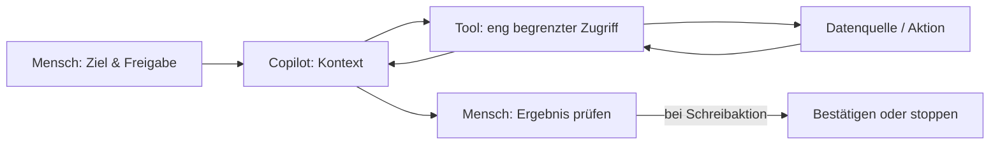
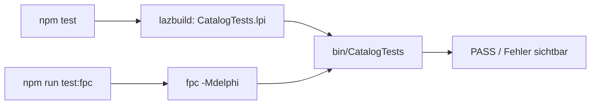

# Workshop: GitHub Copilot von A bis Z

## Delphi · Lazarus · geführte Übungen

**EKON 30 · Düsseldorf, November 2026 · Harald Binkle & Thomas Tomow**

<!--
Start: heute baut jede Person ein kleines Delphi-kompatibles Pascal-Feature mit Lazarus/Free Pascal und passt Copilot an ein konkretes Projekt an. Der Browser-Guide begleitet die Übungen in VS Code; kein RAD Studio erforderlich.
-->

---
title: Speaker
layout: intro
src: /special-slides/ekon30-speakers.md

---

---
title: Vorbereitung
layout: default
hideInToc: true
---

# Vorbereitung: Delphi-Werkbank

<div class="grid grid-cols-2 gap-10 items-center mt-6">

<div>

**Bitte mitbringen**

<v-clicks>

- Windows: PowerShell; macOS: Terminal (Git-/npm-Befehle sind identisch)
- Lazarus mit `lazbuild` und Free Pascal mit `fpc` im `PATH`
- VS Code, Git, Node.js 24+ und Copilot
- Repo klonen, Tests und Guide starten

</v-clicks>

```powershell
git clone https://github.com/harrybin/ekon30-github-copilot-workshop.git
cd ekon30-github-copilot-workshop
fpc -iV
lazbuild --version
npm test
npm run guide
```

**Repo:** [github.com/harrybin/ekon30-github-copilot-workshop](https://github.com/harrybin/ekon30-github-copilot-workshop)

</div>

<div class="text-center">

<QRCode
  type="svg"
  :data="'https://github.com/harrybin/ekon30-github-copilot-workshop'"
  :dotsOptions="{ color: '#164e8a', type: 'extra-rounded', roundSize: false }"
  :backgroundOptions="{ color: '#ffffff' }"
  :width="220"
  :height="220"
/>

<p>Repo → README → Setup → Guide</p>

</div>

</div>

<!--
Vorbereitung: README im Übungsrepo lesen, Repository klonen und als eigenen VS-Code-Ordner öffnen. fpc -iV und lazbuild --version prüfen. npm test baut mit lazbuild und startet die Pascal-Checks. Node.js dient nur dem Guide und den Build-Aufrufen, nicht den Codeübungen. Workshop-Abstract: https://entwickler-konferenz.de/ki-praxis-und-tools-fuer-delphi/workshop-github-copilot-von-a-bis-z. Decksammlung: https://github.com/harrybin/presentations.
-->

---
title: Toolchain · zuerst den Compiler finden
layout: two-cols
---

# Vor dem Copilot-Chat: Build grün bekommen

::left::

**Windows · PowerShell**

```powershell
Get-Command lazbuild, fpc
lazbuild --version
fpc -iV
npm test
```

::right::

**macOS · Terminal**

```sh
command -v lazbuild fpc
lazbuild --version
fpc -iV
npm test
```

<!--
Windows ist der empfohlene Workshop-Pfad; macOS nutzt dieselben npm-Befehle. `npm test` braucht `lazbuild`; `fpc -iV` und `lazbuild --version` prüfen die Installation. Quelle: https://github.com/harrybin/ekon30-github-copilot-workshop/blob/main/README.md.
-->

---
title: Geführter Workshop
layout: default
hideInToc: true
---

# Dein Guide neben dem Pascal-Code

<div class="grid grid-cols-2 gap-10 mt-6">
<div>

**Verstehen → Umsetzen → Prüfen**

<v-clicks>

- sieben Übungen mit klaren Zeitboxen
- Copilot-Prompts bewusst kopieren
- Hinweise bei Bedarf aufklappen
- eigene Nachweise und Notizen exportieren

</v-clicks>

</div>
<div>

**Start in VS Code**

```powershell
npm run guide
```

`Simple Browser: Show` öffnen und die **vollständige URL aus dem Terminal** einfügen.

Fortschritt bleibt lokal. Haken sind **Selbstauskunft**, keine automatischen Tests.

</div>
</div>

<!--
Vorbild: https://github.com/octodemo/copilot-governance-at-scale
Unser Guide ist eine eigenständige lokale Browser-Oberfläche, keine registrierte native Copilot-Canvas-Erweiterung. In VS Code neben dem Code im Simple Browser oder in einem normalen Browser öffnen. In der Copilot App bei lokalem Checkout den Browser-Arbeitsbereich verwenden, sofern verfügbar, sonst den Systembrowser. Keine automatische Terminalausführung oder Agent-Actions. Prüfschritte werden nur mit eigenem Nachweis als selbst bestätigt gezählt.
Referenzen für die Workshop-Vorbereitung: https://github.com/harrybin/ekon30-github-copilot-workshop und https://github.com/octodemo/copilot-governance-at-scale.
-->

---
title: Copilot-Oberflächen · Vorschlag oder Auftrag?
layout: default
---

# Das Werkzeug folgt dem Umfang

<div class="grid grid-cols-3 gap-6 mt-6">

<div v-click class="p-4 rounded-lg bg-blue-900/20">
<strong>Completion</strong>
<p>Lokaler Vorschlag am Cursor. Ihr nehmt an, ändert oder verwerft.</p>
</div>

<div v-click class="p-4 rounded-lg bg-purple-900/20">
<strong>Chat · Ask</strong>
<p>Erklären, vergleichen, planen — ohne Dateien zu verändern.</p>
</div>

<div v-click class="p-4 rounded-lg bg-emerald-900/20">
<strong>Agent</strong>
<p>Mehrschrittige Änderung mit Toolaufrufen. Scope und Nachweis vorher festlegen.</p>
</div>

</div>

<!--
Verschiedene Oberflächen und Agent-Fähigkeiten unterscheiden sich. Erst den niedrigsten passenden Autonomiegrad wählen und keinen Schreibauftrag allein aus dem UI-Modus ableiten. Referenz: https://docs.github.com/en/copilot/reference/customization-cheat-sheet.
-->

---
title: Demo Time · Dateien auf die Bühne holen
layout: image-right
background: bmad-human-ai-copilot.png
---

# Demo Time führt — ihr entscheidet

<v-clicks>

- `01-delphi-workshop.json` bündelt die Szenen zu sieben Übungen
- `02-presenter-capstone.json` zeigt den echten Agent-Auftrag
- Demo Time öffnet Dateien — es sendet keine Prompts und startet keine Tests
- Copilot, Freigabe und Terminal bleiben sichtbar manuell

</v-clicks>

```json
{
  "id": "real-copilot-request",
  "moves": [
    { "action": "open", "path": "exercises/07-capstone.md" },
    { "action": "open", "path": "src/SessionCatalog.pas" },
    { "action": "open", "path": "tests/CatalogTests.lpr" }
  ]
}
```

<!--
Demo Time ist eine optionale VS-Code-Erweiterung. In einem separaten Presenter-Checkout die Szene `real-copilot-request` aus `.demo/02-presenter-capstone.json` manuell starten; Teilnehmenden-Checkouts bleiben unberührt. Danach den Prompt in Copilot selbst starten, Plan und Diff prüfen und Tests im eigenen Terminal ausführen. Quellen: https://github.com/harrybin/ekon30-github-copilot-workshop/blob/main/.demo/01-delphi-workshop.json, https://github.com/harrybin/ekon30-github-copilot-workshop/blob/main/.demo/02-presenter-capstone.json, https://github.com/harrybin/ekon30-github-copilot-workshop/blob/main/.demo/presenter-capstone.md.
-->

---
layout: cover
coverImage: pilot-large.jpg
isDark: true
hideInToc: true
---

# Copilot schreibt schneller.

## Ihr entscheidet, was richtig ist.

<v-clicks>

- Vorschläge sind Hypothesen, keine Belege.
- Kontext macht den Unterschied.
- Tests und Review bleiben Teil der Arbeit.

</v-clicks>

<!--
Teaser: Wir versprechen nicht „Code per Knopfdruck“, sondern üben einen sicheren, wiederholbaren Entwicklungsfluss.
-->

---
title: Sessionprofil
layout: image-right
background: ekon30-github-copilot-a-bis-z/copilot-chat-tools.png
hideInToc: true
---

# Am Ende habt ihr ein gebautes Feature

<v-clicks>

- **Zielgruppe:** Delphi-Entwickler:innen mit und ohne Copilot-Erfahrung
- **Toolchain:** VS Code + Lazarus/Free Pascal, kein RAD Studio nötig
- **Ergebnis:** Feature mit Tests plus projektspezifische Copilot-Anpassung
- **Arbeitsmodus:** kurze Inputs, angeleitete Übungen, gemeinsamer Capstone

</v-clicks>

<!--
Vorabhinweis: Lazarus inklusive Free Pascal und PATH vorbereiten. Sprachunterstützung in VS Code ist hilfreich, aber keine kostenpflichtige Delphi-Erweiterung ist Voraussetzung. Inline-Completions werden in VS Code geübt; Chat und Agent-Aufgaben können auch in der Copilot App erfolgen.
-->

---
title: Agenda
layout: default
hideInToc: true
---

# Gemeinsam sicher mit Copilot arbeiten

<v-clicks>

- Lazarus, Guide und sicherer Arbeitsmodus
- Completions und Chat · Übungen 1–2
- Agent Mode · Übung 3
- Instructions und Prompt Files · Übung 4
- Skills und Custom Agents · Übung 5
- Tools und MCP · Übung 6
- Zwei Pausen
- Capstone, Review und Transfer

</v-clicks>

<!--
Zwei Pausen sind eingeplant. Vorab-Setup ist erforderlich, damit wir die Übungszeit nicht mit Installationen verbrauchen. Alle Codeaufgaben verwenden Delphi-kompatibles Object Pascal, gebaut mit Lazarus.
-->

---
layout: chapter
background: ekon30-github-copilot-a-bis-z/copilot-completion.png
isDark: true
---

# 01 · Ein guter Startpunkt

<!--
Wir beginnen mit der kleinsten Delegation: Copilot schlägt vor, der Mensch entscheidet.
-->

---
title: "Arbeitsmodell: Vorschlag, Prüfung, Entscheidung"
layout: image-right
background: gh-copilot-logo.png
---

# Copilot ergänzt — nicht eure Verantwortung

<v-clicks>

- kleinen, klaren Kontext bereitstellen
- Vorschläge lesen und fachlich prüfen
- Änderungen testen und als Diff reviewen
- sensible Daten und untrusted code nicht unbesehen teilen/ausführen

</v-clicks>

<!--
Leitplanke für den Tag: keine Secrets in Prompts, keine unbekannten Skripte blind ausführen, keine Änderungen ohne Review mergen.
-->

---
title: Live-Demo · Vorschlag prüfen statt übernehmen
layout: image-right
background: ekon30-github-copilot-a-bis-z/copilot-completion.png
---

# Erst Verhalten, dann Vorschlag

<v-clicks>

- eine kleine Funktion im Pascal-Code vervollständigen lassen
- Grenzfall und erwartetes Verhalten benennen
- Vorschlag gegen Test und Diff prüfen

</v-clicks>

<!--
Diese kurze Vorführung gehört in die vorhandene Demo-Zeit von Übung 1: ein Completion-Vorschlag ist eine Hypothese. Danach übernehmen die Teilnehmenden denselben Prüfschritt selbst im Workshop-Repository.
-->

---
title: Foundry-Modelle in VS Code Chat
layout: default
---

# Foundry-Modelle in VS Code Chat

<ol class="grid grid-cols-3 gap-7 mt-6 pl-6">

<li v-click>
<strong>Model Catalog</strong>
<p>Modell, Region, Deployment-Typ und Nutzungsbedingungen prüfen.</p>
</li>

<li v-click>
<strong>Deployment</strong>
<p>Modell bereitstellen. Der Deployment-Name routet Requests über den Foundry-Endpunkt.</p>
</li>

<li v-click>
<strong>VS Code Chat</strong>
<p><code>Chat: Manage Language Models</code> → <code>Add Models</code> → <strong>Azure</strong>; Endpoint und Deployment-Name konfigurieren.</p>
</li>

</ol>

<p v-click class="mt-5 text-sm"><strong>Agent Mode:</strong> BYOK aktivieren und ein Modell mit Tool Calling wählen. Code-Completions bleiben Copilot; Azure-Aufrufe werden separat abgerechnet. Für Foundry-Modelle ist alternativ das Foundry Toolkit als Provider-Extension verfügbar.</p>

<!--
Kurzer Exkurs (2–3 Min.) innerhalb der bestehenden Zeit für Chat/Completions; Agenda und Gesamtzeit bleiben unverändert. Keine echten Schlüssel zeigen. In Copilot-Harness-Sessions muss `chat.agentHost.byokModels.enabled` aktiv sein; Agent-Modelle benötigen Tool Calling.
Quellen: https://code.visualstudio.com/docs/agent-customization/language-models, https://learn.microsoft.com/en-us/azure/foundry/foundry-models/concepts/endpoints, https://github.blog/changelog/2026-04-22-bring-your-own-language-model-key-in-vs-code-now-available/.
-->

---
layout: chapter
background: ekon30-github-copilot-a-bis-z/copilot-completion.png
isDark: true
---

# Übung 01 · Vom Kommentar zum Verhalten

<!--
Übungsabschnitt 1. Die Aufgabe ergänzt `FormatSessionCaption` in `src/SessionCatalog.pas`; Details und Prüfschritte: https://github.com/harrybin/ekon30-github-copilot-workshop/blob/main/exercises/01-completions.md.
-->

---
title: Magic Move · Funktion entsteht
layout: default
---

# Ein Testfall schärft den Vorschlag

````md magic-move
```pascal
function FormatSessionCaption(const Session: TSession): string;
```

```pascal
function FormatSessionCaption(const Session: TSession): string;
begin
  Result := Session.Title;
end;
```

```pascal
function FormatSessionCaption(const Session: TSession): string;
begin
  Result := Session.Title;
  if Session.Speaker <> '' then
    Result := Result + ' | ' + Session.Speaker;
end;
```
````

<p class="text-sm mt-4">Leerem Speaker kein Trennzeichen hinzufügen. Beide Fälle testen.</p>

<!--
Magic Move zeigt eine mögliche schrittweise Entwicklung; es ist kein vorweggenommenes Copilot-Ergebnis. Teilnehmende sollen den Vorschlag selbst schreiben, verändern oder verwerfen. Quelle: https://github.com/harrybin/ekon30-github-copilot-workshop/blob/main/exercises/01-completions.md.
-->

---
title: Test-Harness · Was zählt als Nachweis?
layout: default
---

# Ein `PASS` wird nur bei erfüllter Bedingung ausgegeben

```pascal
procedure Check(Condition: Boolean; const Description: string);
begin
  if not Condition then
    raise Exception.Create('FAIL: ' + Description);
  Inc(Checks);
  WriteLn('PASS: ', Description);
end;
```

<v-clicks>

- der Test muss wirklich aufgerufen werden
- ein erfolgreicher Compilerlauf allein genügt nicht
- nach Änderungen: `npm test` und `git diff`

</v-clicks>

<!--
Der Auszug stammt aus dem vorhandenen `tests/CatalogTests.lpr`-Harness. Der Zähler zählt aufgerufene Checks; neue Cases müssen in `TestCatalog` oder einer tatsächlich aufgerufenen Prozedur landen. Quelle: https://github.com/harrybin/ekon30-github-copilot-workshop/blob/main/tests/CatalogTests.lpr.
-->

---
title: Übung 1 · Completion im eigenen Rhythmus
layout: image-left
background: ekon30-github-copilot-a-bis-z/copilot-completion.png
---

# Kleine Funktion, echter Test

<v-clicks>

- `FormatSessionCaption` in einer Pascal-Unit ergänzen
- Copilot-Vorschlag annehmen, verändern oder verwerfen
- Grenzfall selbst ergänzen und mit Test absichern
- **Ergebnis:** Funktion + Test + kurzer Review-Kommentar

</v-clicks>

**Guide 1 · 30 Min.** → [Übung: Completions](https://github.com/harrybin/ekon30-github-copilot-workshop/blob/main/exercises/01-completions.md)

<!--
Geführte Übung: 5 Min Demo, 15 Min eigenes Arbeiten, 10 Min Checkpoint. In src/SessionCatalog.pas eine neue Funktion ergänzen und in tests/CatalogTests.lpr prüfen. npm test baut mit lazbuild und startet die Tests. Sprache ist Object Pascal im Delphi-Modus. Im Guide die Prüfkriterien und eigene Beobachtung festhalten.
-->

---
layout: chapter
background: ekon30-github-copilot-a-bis-z/copilot-chat-tools.png
isDark: true
---

# Übung 02 · Erst verstehen, dann fragen

<v-clicks>

- Quellcode und Checks gezielt als Kontext beilegen
- Behauptungen im Code verifizieren
- genau eine offene Anforderung auswählen

</v-clicks>

<!--
Übungsabschnitt 2. Die Beschreibung der Suchlogik und der Grenzen ist in `exercises/02-chat.md` festgehalten: https://github.com/harrybin/ekon30-github-copilot-workshop/blob/main/exercises/02-chat.md.
-->

---
title: Chat-Prompt · Verhalten statt Bauchgefühl
layout: two-cols
---

# Erst analysieren — noch nichts ändern

::left::

```text
Erkläre FilterSessions und die
Checks in CatalogTests.lpr.

Ändere noch nichts.
Wo werden dynamische Arrays
kopiert?
```

::right::

```text
Welche Eingaben sind belegt?
Welche Anforderungen bleiben offen?
Erfinde keine Unicode-Garantien.

Schlage genau einen zusätzlichen
fachlichen Test vor.
```

<p class="text-sm mt-3">Ask zuerst · Code lesen · eine Hypothese prüfen</p>

<!--
Der Prompt ist eine gekürzte, inhaltlich gleichwertige Darstellung der Übungsanweisung; erst die Antworten am konkreten Pascal-Code prüfen. Der Starter unterstützt bei der Suche ASCII-Groß-/Kleinschreibung, keine vollständige Unicode-Normalisierung. Quelle: https://github.com/harrybin/ekon30-github-copilot-workshop/blob/main/exercises/02-chat.md.
-->

---
title: Code-Lupe · FilterSessions
layout: default
---

# Drei Schritte — und eine wichtige Grenze

```pascal
NormalizedQuery := LowerCase(Trim(Query));
SearchText := LowerCase(
  Sessions[I].Title + ' ' + Sessions[I].Speaker + ' ' + Sessions[I].Track
);
if (NormalizedQuery = '') or (Pos(NormalizedQuery, SearchText) > 0) then
begin
  SetLength(Result, Count + 1);
  Result[Count] := Sessions[I];
  Inc(Count);
end;
```

<v-clicks>

- Leerzeichen außen und ASCII-Groß-/Kleinschreibung werden normalisiert
- gesucht wird über Titel, Speaker und Track
- vollständige Unicode-Normalisierung ist nicht zugesichert

</v-clicks>

<!--
Der Ausschnitt ist aus `src/SessionCatalog.pas` übernommen und gekürzt. Suchtext wird aus drei Feldern zusammengesetzt; im Workshop keine weitergehenden Unicode- oder Feldgrenzen-Garantien behaupten. Quelle: https://github.com/harrybin/ekon30-github-copilot-workshop/blob/main/src/SessionCatalog.pas.
-->

---
title: Belegt oder offen?
layout: two-cols
---

# Chat-Antworten am Repository messen

::left::

**Im Code belegbar**

<v-clicks>

- leere Suche liefert alle Sessions
- Treffer bleiben in Eingabereihenfolge
- ein zusätzlicher Test läuft über `Check`

</v-clicks>

::right::

**Nicht versprechen**

<v-clicks>

- komplette Unicode-Case-Folding-Regeln
- Suche nur innerhalb einzelner Felder
- unveränderte Semantik bei neuem Scope

</v-clicks>

<!--
Die Aussagen links und die Grenzen rechts folgen dem Starter und Übung 2. Eine neue Semantik wäre ein eigener Auftrag mit Akzeptanzkriterien, kein beiläufiges Chat-Refactoring. Quelle: https://github.com/harrybin/ekon30-github-copilot-workshop/blob/main/exercises/02-chat.md.
-->

---
title: Übung 2 · Chat mit Arbeitskontext
layout: image-right
background: ekon30-github-copilot-a-bis-z/copilot-chat-tools.png
---

# Erst verstehen, dann ändern

<v-clicks>

- `FilterSessions` und dynamische Arrays erklären lassen
- Refactoring oder Tests als separaten Auftrag formulieren
- Scope, Nicht-Ziele und erwarteten Output nennen
- **Ergebnis:** nachvollziehbarer Plan und eine geprüfte Verbesserung

</v-clicks>

**Guide 2 · 35 Min.** → [Übung: Chat](https://github.com/harrybin/ekon30-github-copilot-workshop/blob/main/exercises/02-chat.md)

<!--
Geführt: erst Ask/Explain ohne Edit, dann genau einen Randfall testen. Teilnehmende vergleichen Antwort und tatsächlichen Pascal-Code, insbesondere const und Array-Aliasing. Keine unbelegten Unicode-Garantien. Beobachtung im Guide dokumentieren, danach erste Pause.
-->

---
layout: chapter
background: secret-agent-large.png
isDark: true
---

# 02 · Vom Chat zur agentischen Aufgabe

<!--
Übergang: Agent Mode darf mehr tun. Darum muss der Auftrag enger und die Verifikation stärker sein.
-->

---
title: Agent-Auftrag in fünf Teilen
layout: default
---

# Gute Delegation ist konkret

<div class="ekon30-flow ekon30-flow--five">
  <div v-click class="ekon30-flow__step">
    <strong>Ziel</strong>
    <p>Welches Verhalten soll entstehen?</p>
  </div>
  <div v-click class="ekon30-flow__step">
    <strong>Kontext</strong>
    <p>Welche Dateien und Regeln zählen?</p>
  </div>
  <div v-click class="ekon30-flow__step">
    <strong>Grenzen</strong>
    <p>Was soll ausdrücklich unverändert bleiben?</p>
  </div>
  <div v-click class="ekon30-flow__step">
    <strong>Nachweis</strong>
    <p>Welche Tests oder Checks müssen laufen?</p>
  </div>
  <div v-click class="ekon30-flow__step">
    <strong>Rückmeldung</strong>
    <p>Änderungen, Annahmen und offene Fragen nennen</p>
  </div>
</div>

<!--
Ein gutes Prompt-Beispiel live formulieren. Nicht die Länge zählt, sondern klare Erfolgskriterien und ein sicherer Umfang.
-->

---
title: Live-Demo · Agent Mode mit Stopppunkt
layout: image-right
background: bmad-human-ai-copilot.png
---

# Plan lesen, Scope prüfen, dann bauen

<div class="ekon30-flow ekon30-flow--four">
  <div v-click class="ekon30-flow__step">
    <strong>Auftrag geben</strong>
    <p>Ziel, Kontext und Grenzen benennen</p>
  </div>
  <div v-click class="ekon30-flow__step">
    <strong>Plan prüfen</strong>
    <p>Fragen und betroffene Dateien ansehen</p>
  </div>
  <div v-click class="ekon30-flow__step">
    <strong>Freigeben</strong>
    <p>Umsetzung erst nach Scope-Check</p>
  </div>
  <div v-click class="ekon30-flow__step">
    <strong>Nachweisen</strong>
    <p>Tests und Diff gemeinsam prüfen</p>
  </div>
</div>

<!--
Diese Vorführung nutzt die bestehende Demo-Zeit und den Auftrag aus Übung 3. Bei breitem Scope stoppen, den Plan korrigieren und keine Änderungen ungeprüft übernehmen.
-->

---
layout: chapter
background: secret-agent-large.png
isDark: true
---

# Übung 03 · Agent Mode mit überprüfbarem Vertrag

<v-clicks>

- Akzeptanzkriterien machen den Auftrag prüfbar
- Nicht-Ziele halten den Scope klein
- Tests belegen Verhalten — der Agentenbericht allein nicht

</v-clicks>

<!--
Übungsabschnitt 3. Der echte Backlog-Vertrag und die Übung stehen hier: https://github.com/harrybin/ekon30-github-copilot-workshop/blob/main/backlog/feature-request.md und https://github.com/harrybin/ekon30-github-copilot-workshop/blob/main/exercises/03-agent-mode.md.
-->

---
title: Backlog als technischer Vertrag
layout: default
---

# Gleicher Track heißt wirklich gleich

```pascal
type
  TTrackCount = record
    Track: string;
    Count: Integer;
  end;
  TTrackCounts = array of TTrackCount;

function CountSessionsByTrack(
  const Sessions: TSessions
): TTrackCounts;
```

<v-clicks>

- erster Auftritt bestimmt die Reihenfolge
- `KI` und `ki` bleiben getrennte Schlüssel
- leerer Track ist ein gültiger Schlüssel
- leere Eingabe ergibt ein leeres dynamisches Array

</v-clicks>

<!--
Diese Signatur und die fachlichen Kriterien stammen aus dem Backlog. Auch unveränderte Eingabedaten und tatsächlich aufgerufene Tests sind Teil des Vertrags; keine Sortierung oder neuen Abhängigkeiten ergänzen. Quelle: https://github.com/harrybin/ekon30-github-copilot-workshop/blob/main/backlog/feature-request.md.
-->

---
title: Plan-only · Auftrag erst prüfen
layout: default
---

# Erst den Plan freigeben, nicht die Vermutung

````md magic-move
```text
Plane CountSessionsByTrack gemäß
backlog/feature-request.md.
```

```text
Plane CountSessionsByTrack gemäß
backlog/feature-request.md.

Scope: SessionCatalog.pas und
CatalogTests.lpr.
```

```text
Plane CountSessionsByTrack gemäß
backlog/feature-request.md.

Scope: SessionCatalog.pas und
CatalogTests.lpr.

Nenne offene Fragen und Tests.
Warte vor der Umsetzung auf Freigabe.
```
````

<v-clicks>

- Dateien und Nicht-Ziele prüfen
- Randfälle gegen Backlog abgleichen
- bei Scope-Drift stoppen und korrigieren

</v-clicks>

<!--
Der gekürzte Plan-only-Auftrag basiert auf dem Prompt aus Übung 3. Umsetzung erst nach expliziter Prüfung freigeben; der Repo-Backlog ist die fachliche Quelle. Quelle: https://github.com/harrybin/ekon30-github-copilot-workshop/blob/main/exercises/03-agent-mode.md.
-->

---
title: Testmatrix · CountSessionsByTrack
layout: default
---

# Erfolgskriterien werden Testfälle

| Eingabe | Erwartetes Ergebnis |
|---|---|
| `KI`, `Delphi`, `KI` | `KI = 2`, `Delphi = 1` |
| `KI` und `ki` | zwei verschiedene Tracks |
| leerer Track | eigener Eintrag |
| leere Eingabe | leeres Ergebnis |
| beliebiger Fall | Eingabe bleibt unverändert |

<p v-click class="mt-4">Zusätzlich: Reihenfolge des ersten Auftretens erhalten.</p>

<!--
Die Matrix fasst die Akzeptanzkriterien aus `backlog/feature-request.md` zusammen. Tests müssen tatsächlich aufgerufen werden; nicht vorhandene Anforderungen wie Sortierung bleiben Nicht-Ziel. Quelle: https://github.com/harrybin/ekon30-github-copilot-workshop/blob/main/backlog/feature-request.md.
-->

---
title: Übung 3 · Feature mit Agent Mode
layout: image-right
background: bmad-human-ai-copilot.png
---

# Planen, umsetzen, reviewen

<v-clicks>

- `CountSessionsByTrack` aus dem Backlog umsetzen
- Agent zuerst Plan und offene Fragen liefern lassen
- Task nach Freigabe umsetzen und Tests ausführen lassen
- **Ergebnis:** Feature-Branch mit Test, geprüftem Diff und Notizen

</v-clicks>

**Guide 3 · 40 Min.** → [Übung: Agent Mode](https://github.com/harrybin/ekon30-github-copilot-workshop/blob/main/exercises/03-agent-mode.md)

<!--
Zeitbox: 8 Min gemeinsames Plan-Beispiel, 22 Min Umsetzung, 10 Min Diff-/Testreview. In der Demo bewusst einen Randfall einbauen. Falls der Agent zu breit arbeitet: stoppen, Scope verkleinern, Plan aktualisieren.
-->

---
title: Review · Diff ist Teil des Ergebnisses
layout: default
---

# Vier Fragen vor dem nächsten Auftrag

<v-clicks>

- Passt jede geänderte Datei zum freigegebenen Scope?
- Decken Tests Randfälle und Nicht-Ziele ab?
- Sind Änderungen an bestehenden Erwartungen begründet?
- Stimmen Testausgabe und Bericht mit dem echten Lauf überein?

</v-clicks>

```powershell
npm test
git diff --check
git diff -- src/SessionCatalog.pas tests/CatalogTests.lpr
```

<!--
Die Befehle und Reviewgrenzen entsprechen der Agent-Mode-Übung. Änderungen nicht automatisch zurücksetzen: Fehler, Tests und Diff sichtbar untersuchen. Quelle: https://github.com/harrybin/ekon30-github-copilot-workshop/blob/main/exercises/03-agent-mode.md.
-->

---
title: Instructions oder Prompt File?
layout: image-left
background: ekon30-github-copilot-a-bis-z/copilot-project-rules.png
---

# Dauerhafte Regeln vs. wiederholbarer Auftrag

<v-clicks>

- **Instructions:** gelten automatisch im definierten Projekt-/Dateikontext
- **Prompt File:** wird bewusst für eine konkrete wiederholbare Aufgabe aufgerufen
- **Faustregel:** Teamstandard automatisch; Arbeitsablauf gezielt starten

</v-clicks>

<!--
Beispiele: Delphi/FPC-Kompatibilität, unveränderte Eingabearrays und npm test in Instructions; „Prüfe Tests für diese Änderung“ als Prompt File. Copilot-Featureunterstützung hängt von IDE und Oberfläche ab.
Quelle: https://docs.github.com/en/copilot/reference/customization-cheat-sheet
-->

---
layout: chapter
background: ekon30-github-copilot-a-bis-z/copilot-project-rules.png
isDark: true
---

# Übung 04 · Projektregeln und Prompt Files

<v-clicks>

- wiederkehrende Standards in Projektkontext halten
- manuell gestartete Review-Aufgabe separat beschreiben
- Vorher und Nachher mit gleichem Auftrag vergleichen

</v-clicks>

<!--
Übungsabschnitt 4. Die Aufgabe ergänzt bestehende Projektregeln und erstellt ein bewusst aufgerufenes Review-Prompt-File: https://github.com/harrybin/ekon30-github-copilot-workshop/blob/main/exercises/04-instructions-prompts.md.
-->

---
title: Konfiguration · Regeln, die prüfbar sind
layout: two-cols
---

# Projektkontext für Pascal

::left::

**`AGENTS.md`**

````md magic-move
```md
- Pascal bleibt kompatibel mit FPC Delphi mode.
```

```md
- Pascal bleibt kompatibel mit FPC Delphi mode.
- Catalog-Operationen ändern nicht ihre Eingabearrays.
```

```md
- Pascal bleibt kompatibel mit FPC Delphi mode.
- Catalog-Operationen ändern nicht ihre Eingabearrays.
- Nach Pascal-Änderungen: npm test
  und npm run test:fpc.
```
````

::right::

**`.github/prompts/test-review.prompt.md`**

```md
---
description: Prüfe Tests einer Pascal-Änderung.
---

Prüfe Akzeptanzkriterien, leere Arrays,
Alias-Effekte und tatsächlich ausgeführte
Checks. Schwäche Tests nicht ab.
```

<!--
Die Projektregeln links sind der Inhalt der Workshop-`AGENTS.md`, rechts ein Beispiel für ein Prompt File, dessen Frontmatter die kurze Beschreibung enthält. Instructions sind dauerhafter Kontext; Prompt Files werden gezielt gestartet. Oberflächen-Unterstützung kann variieren. Quellen: https://github.com/harrybin/ekon30-github-copilot-workshop/blob/main/AGENTS.md, https://github.com/harrybin/ekon30-github-copilot-workshop/blob/main/exercises/04-instructions-prompts.md, https://docs.github.com/en/copilot/reference/customization-cheat-sheet.
-->

---
title: Scoped Instructions · nur passende Dateien
layout: default
---

# Kontext nach Dateityp eingrenzen

```md
<!-- .github/instructions/pascal.instructions.md -->
---
applyTo: "**/*.pas"
---

Verwende den FPC-Delphi-Modus.
Ändere keine Eingabearrays.
```

<v-clicks>

- Globales `AGENTS.md`: Projektregeln
- `applyTo`: gezielter Datei-Kontext
- Laufzeit und Feature-Support vorher prüfen

</v-clicks>

<!--
Die `.github/instructions/*.instructions.md`-Variante ist ein alternatives Muster, kein zusätzlicher Workshop-Zwang. `applyTo` schränkt den Geltungsbereich ein; Oberflächenunterstützung und Priorität der Instruktionen prüfen. Referenz: https://docs.github.com/en/copilot/reference/customization-cheat-sheet.
-->

---
title: Prompt Files · Inputs und Ergebnis formen
layout: default
---

# Ein wiederholbarer Auftrag hat einen Output-Vertrag

<div class="grid grid-cols-3 gap-6 mt-6">

<div v-click class="p-4 rounded-lg bg-blue-900/20">
<strong>Input</strong>
<p>Diff, Akzeptanzkriterien, betroffene Tests</p>
</div>

<div v-click class="p-4 rounded-lg bg-purple-900/20">
<strong>Prüfung</strong>
<p>Leere Arrays, Aliasing, Delphi/FPC-Modus</p>
</div>

<div v-click class="p-4 rounded-lg bg-emerald-900/20">
<strong>Output</strong>
<p>Befunde, Testnachweis, offene Punkte</p>
</div>

</div>

<!--
Aus Übung 4 abgeleiteter Review-Auftrag. Ein Prompt File startet die Aufgabe bewusst; es ersetzt keine dauerhaften Projektregeln und behauptet keinen Testlauf, der nicht ausgeführt wurde. Quelle: https://github.com/harrybin/ekon30-github-copilot-workshop/blob/main/exercises/04-instructions-prompts.md.
-->

---
title: Übung 4 · Projektkontext anpassen
layout: image-right
background: ekon30-github-copilot-a-bis-z/copilot-project-rules.png
---

# Regeln sichtbar machen

<v-clicks>

- drei überprüfbare Projektregeln aus dem Repository ableiten
- passende `.github/copilot-instructions.md` oder gezielte Instruction-Datei schreiben
- ein Prompt File für einen wiederkehrenden Task erstellen
- **Ergebnis:** Vorher/Nachher-Beispiel, das die Regelwirkung zeigt

</v-clicks>

**Guide 4 · 35 Min.** → [Übung: Instructions & Prompts](https://github.com/harrybin/ekon30-github-copilot-workshop/blob/main/exercises/04-instructions-prompts.md)

<!--
Geführt: Regeln als konkrete Vorgaben schreiben, nicht als Wunschliste. Mit demselben Auftrag vorher/nachher vergleichen. Keine sensiblen oder personenbezogenen Repo-Inhalte verwenden.
-->

---
layout: chapter
background: bmad-agents-specialized-experts.png
isDark: true
---

# 03 · Fähigkeiten passend zuschneiden

<!--
Die Begriffe sauber unterscheiden: Skills laden Wissen/Schritte nach Bedarf, Custom Agents geben einer Rolle eigene Anweisungen und Tool-Grenzen, MCP verbindet externe Tools und Daten.
-->

---
title: Skills, Agents und Tools sind verschieden
layout: image-right
background: bmad-agent-fleet.png
---

# Drei Bausteine — drei Aufgaben

<v-clicks>

- **Skill:** gebündelte Anleitung, Ressourcen und ggf. Skripte für einen Workflow
- **Custom Agent:** spezialisierte Rolle mit eigenen Regeln und Fähigkeiten
- **MCP/Tool:** konkrete Aktion oder Datenquelle außerhalb des Modells

</v-clicks>

<!--
Ein Skill ist nicht einfach ein anderer Name für Agent. Toolzugriffe können Folgen haben; nur nötige Rechte freigeben und die Toolbeschreibung prüfen.
Quelle: https://docs.github.com/en/copilot/reference/customization-cheat-sheet
-->

---
layout: chapter
background: bmad-agents-specialized-experts.png
isDark: true
---

# Übung 05 · Wissen laden, Rolle begrenzen

<v-clicks>

- Skill: wiederverwendbarer Ablauf mit Wissen und Checkliste
- Custom Agent: spezialisierte Rolle mit passenden Fähigkeiten
- Tool: konkrete Aktion — nur mit nötiger Berechtigung

</v-clicks>

<!--
Übungsabschnitt 5. Der Workshop erstellt die Review-Hilfe unter `.github/skills/catalog-test-review/SKILL.md`; ein Reviewer-Agent ist optional. Quelle: https://github.com/harrybin/ekon30-github-copilot-workshop/blob/main/exercises/05-skills-agents.md.
-->

---
title: Skill-Skelett · Trigger plus Ablauf
layout: two-cols
---

# Wissen ist kein zusätzlicher Agent

::left::

```md
---
name: catalog-test-review
description: >
  Reviewt kleine Pascal-Änderungen,
  wenn Tests und Randfälle geprüft
  werden sollen.
---

1. Kriterien und Pascal-Diff lesen.
2. Randfälle und FPC-Modus prüfen.
3. Echte Tests und offene Punkte nennen.
```

::right::

<v-clicks>

- **Skill** lädt den passenden Workflow bei Bedarf
- **Custom Agent** setzt Rolle und Grenzen
- Toolrechte hängen von der Oberfläche ab
- Erfolg nie aus einer Anleitung ableiten

</v-clicks>

<!--
Frontmatter und Beispielpfad orientieren sich an der Workshop-Aufgabe. Die Übung verlangt einen beobachteten Aufruf oder den ausdrücklich dokumentierten manuellen Kontextweg; keine Toolinstallation ist erforderlich. Quellen: https://github.com/harrybin/ekon30-github-copilot-workshop/blob/main/exercises/05-skills-agents.md, https://docs.github.com/en/copilot/reference/customization-cheat-sheet.
-->

---
title: Custom Agent · Rolle und Grenzen
layout: two-cols
---

# Review-Rolle statt Agenten-Team

::left::

```md
<!-- .github/agents/pascal-reviewer.agent.md -->
---
name: pascal-reviewer
description: Prüft Pascal-Diffs ohne sie zu ändern.
---

Reviewe Anforderungen, Randfälle und
Testnachweis. Schreibe keine Dateien.
```

::right::

<v-clicks>

- Rolle eng und beobachtbar formulieren
- Tools nur nach Fähigkeiten der Oberfläche wählen
- Befunde zeigen, statt selbst zu implementieren
- Skills bleiben optionales Workflow-Wissen

</v-clicks>

<!--
Der Agent ist in Übung 5 optional; Toollisten unterscheiden sich je Copilot-Oberfläche und werden deshalb nicht als universelle Konfiguration gezeigt. Der Workshop empfiehlt eine reine Reviewer-Rolle. Quelle: https://github.com/harrybin/ekon30-github-copilot-workshop/blob/main/exercises/05-skills-agents.md.
-->

---
title: Übung · Team-Workflow als Skill
layout: image-left
background: bmad-context-hierarchy.png
---

# Aus einer Wiederholung wird ein Skill

<v-clicks>

- wiederkehrenden Ablauf in kleine Schritte zerlegen
- erforderliche Inputs und Prüfergebnis festlegen
- Referenzmaterial nur dort ablegen, wo es gebraucht wird
- **Ergebnis:** Skill-Skelett mit Trigger, Ablauf und Checkliste

</v-clicks>

**Guide 5 · 25 Min.** → [Übung: Skills & Agents](https://github.com/harrybin/ekon30-github-copilot-workshop/blob/main/exercises/05-skills-agents.md)

<!--
25 Minuten inklusive Input: Workflow als .github/skills/catalog-test-review/SKILL.md mit Trigger und Prüfschritten anlegen. Reviewer-Agent optional. Tatsächlichen Skill-Aufruf beobachten oder manuellen Kontextweg ausdrücklich dokumentieren. Keine Toolinstallation erforderlich.
-->

---
layout: chapter
background: bmad-governance-control-center.png
isDark: true
---

# Übung 06 · Tools und MCP

<v-clicks>

- lokaler Compiler ist ein Terminal-Tool — kein MCP nötig
- MCP ergänzt eine externe Fähigkeit oder Datenquelle
- Konfiguration allein beweist weder Verbindung noch Sicherheit

</v-clicks>

<!--
Übungsabschnitt 6. Live-MCP ist optional; die lokale Tool- und Rechteanalyse ist immer möglich. Aufgaben und Prompts: https://github.com/harrybin/ekon30-github-copilot-workshop/blob/main/exercises/06-tools-mcp.md.
-->

---
title: MCP · Datenfluss sichtbar machen
layout: default
---

# Von der Frage bis zur Wirkung



<p class="text-sm mt-4">Vorher klären: Herkunft · Datenumfang · Schreibrechte · Bestätigung</p>

<!--
Lokales `npm test` baut und startet Pascal-Tests über die vorhandene Toolchain; dafür muss kein MCP-Server installiert werden. Falls eine vorbereitete Live-MCP-Demo fehlt, die Berechtigungsanalyse als Trockenübung zeigen und nicht als erfolgreiche Verbindung ausgeben. Quelle und Übungsdetails: https://github.com/harrybin/ekon30-github-copilot-workshop/blob/main/exercises/06-tools-mcp.md.
-->

---
title: Berechtigungsmatrix · zuerst minimal
layout: default
---

# Lesend, ausführend und schreibend trennen

| Fähigkeit | Beispiel im Workshop | Grenze |
|---|---|---|
| Dateien lesen | Pascal-Unit und Tests untersuchen | Repository-Kontext |
| lokal ausführen | `npm test` mit Lazarus/FPC | sichtbarer Terminallauf |
| extern schreiben | Issue oder Datenbank ändern | nur mit klarem Bedarf und Freigabe |

<p v-click class="mt-4">Eine MCP-Verbindung ist kein Ersatz für diese Prüfung.</p>

<!--
Die Übung unterscheidet lokale Terminalwerkzeuge von optionaler externer MCP-Funktionalität. Ohne vorbereiteten read-only Server eine Trockenübung als solche markieren. Quelle: https://github.com/harrybin/ekon30-github-copilot-workshop/blob/main/exercises/06-tools-mcp.md.
-->

---
title: "MCP: externe Fähigkeiten bewusst anbinden"
layout: image-right
background: bmad-governance-control-center.png
---

# Erst Nutzen, dann Berechtigung

<v-clicks>

- welche Information/Aktion fehlt Copilot?
- welche minimalen Tools und Rechte reichen?
- sind Datenzugriff, Schreibzugriff und Herkunft nachvollziehbar?
- was braucht menschliche Bestätigung?

</v-clicks>

**Guide 6 · 20 Min.** → [Übung: Tools & MCP](https://github.com/harrybin/ekon30-github-copilot-workshop/blob/main/exercises/06-tools-mcp.md)

<!--
Die lokale Tool-/Rechteanalyse ist Teil des Workshops. Terminal plus lazbuild benötigt keinen MCP-Server. Eine Live-MCP-Demo ist optional und nur mit vorbereitetem lesendem Beispielserver erlaubt. Ohne Server Trockenübung dokumentieren, keinen Live-Nachweis behaupten.
-->

---
title: Unsere Pascal-Toolchain
layout: default
---

# Delphi-Code. Lazarus-Build. Sichtbarer Nachweis.

```pascal
function FindSessionIndex(const Sessions: TSessions;
  const Id: string): Integer;
```

<v-clicks>

- `src/SessionCatalog.pas` · Delphi-kompatibles Object Pascal
- `CatalogDemo.lpi` · Konsolenprojekt ohne VCL/FMX
- `npm test` · Lazarus baut **und startet** die Pascal-Tests
- `npm run build` · Anwendung mit `lazbuild` bauen

</v-clicks>

<!--
FPC wird im Delphi-Modus verwendet. Keine JavaScript-Ersatzübungen, keine RAD-Studio-Lizenz erforderlich. Node.js ist nur der plattformübergreifende Starter für Guide und Toolchain. Die beiden .lpi-Dateien lassen sich alternativ direkt in Lazarus öffnen; danach Tests tatsächlich starten. Vollständige RAD-Studio-Kompatibilität wird nicht behauptet.
-->

---
title: Testpfade · Lazarus und direktes FPC
layout: default
---

# Build ist nicht gleich Test



<v-clicks>

- `npm test`: Lazarus-Projekt bauen **und** Tests starten
- `npm run test:fpc`: direkter FPC-Delphi-Modus
- beide Pfade prüfen verschiedene Voraussetzungen

</v-clicks>

<!--
Die Befehle sind aus `package.json`, `scripts/pascal.mjs` und dem README des Workshop-Repositories abgeleitet. `npm test` benötigt lazbuild; der direkte Test braucht fpc. Nur tatsächliche Ausgaben als erfolgreich melden. Quelle: https://github.com/harrybin/ekon30-github-copilot-workshop/blob/main/scripts/pascal.mjs.
-->

---
title: Fehlersuche · erst die Toolchain, dann der Prompt
layout: default
---

# Fehlerausgaben haben unterschiedliche Ursachen

<v-clicks>

- `lazbuild` fehlt → Lazarus/FPC-Pfad prüfen
- `fpc` fehlt → direkte Testvariante nicht verfügbar
- Compilerfehler → Datei, Zeile und Modus lesen
- Assertion schlägt fehl → Erwartung gegen Backlog prüfen
- Test wird nicht gefunden → Starter und Projektpfad prüfen

</v-clicks>

<!--
Die Unterscheidung folgt den beiden Workshop-Testpfaden: `npm test` benötigt lazbuild, `npm run test:fpc` benötigt fpc. Nicht jeden Toolchain-Fehler als Modellfehler oder umgekehrt interpretieren. Quelle: https://github.com/harrybin/ekon30-github-copilot-workshop/blob/main/README.md.
-->

---
title: Testpfad wählen · Umgebung transparent machen
layout: two-cols
---

# Welchen Nachweis kann ich erbringen?

::left::

**Lazarus vorhanden**

```powershell
npm test
```

Build und Pascal-Testprogramm laufen über `lazbuild`.

::right::

**FPC vorhanden**

```powershell
npm run test:fpc
```

Direkter Delphi-Modus; nicht als Lazarus-Build ausgeben.

<!--
Beide Pfade sind im Workshop-README beschrieben. Trainer und Teilnehmende benennen jeweils die tatsächliche Umgebung und den ausgeführten Pfad. Quelle: https://github.com/harrybin/ekon30-github-copilot-workshop/blob/main/README.md.
-->

---
layout: chapter
background: bmad-human-ai-copilot.png
isDark: true
---

# Übung 07 · Capstone mit Abnahmekriterien

<v-clicks>

- exakter, case-sensitiver Trackvergleich
- Eingabedaten bleiben unverändert
- Treffer, kein Treffer und leere Eingabe testen
- Diff zu zweit prüfen, Beobachtungen exportieren

</v-clicks>

<!--
Übungsabschnitt 7. Das echte Capstone-Prompt ist in `exercises/07-capstone.md`; Demo Time zeigt denselben Auftrag in einem separaten Presenter-Checkout. Quellen: https://github.com/harrybin/ekon30-github-copilot-workshop/blob/main/exercises/07-capstone.md, https://github.com/harrybin/ekon30-github-copilot-workshop/blob/main/.demo/presenter-capstone.md.
-->

---
title: Capstone · Tests machen die Grenze sichtbar
layout: default
---

# Vertrag vor Implementierung

```pascal
function FilterSessionsByTrack(
  const Sessions: TSessions;
  const Track: string
): TSessions;
```

<v-clicks>

- `KI` findet `KI`, nicht `ki`
- Treffer behalten die Eingabereihenfolge
- kein Treffer und leere Eingabe sind getrennte Fälle
- Testlauf plus Diff prüfen — nicht nur Agent-Antwort

</v-clicks>

<!--
Signatur und Verhalten entsprechen dem Capstone-Prompt. Die Präsentation zeigt bewusst Kriterien statt einer vorweggenommenen Lösung. Für die echte Live-Demo zählen nur tatsächlich ausgeführte Tests und der reale Copilot-Diff. Quelle: https://github.com/harrybin/ekon30-github-copilot-workshop/blob/main/exercises/07-capstone.md.
-->

---
title: Demo Time · echter Capstone-Lauf
layout: image-right
background: bmad-human-ai-copilot.png
---

# Zeigt den Ablauf — nicht das Ergebnis vorweg

<v-clicks>

- separaten Presenter-Checkout verwenden
- Copilot erst planen lassen und den Scope prüfen
- Änderung ausdrücklich freigeben, Tests selbst starten
- echte Ausgabe und Diff reviewen; Fehler sichtbar lassen

</v-clicks>

```powershell
npm test
npm run test:fpc
git diff --check
git status --short
```

<!--
Die Demo-Time-Erweiterung führt Dateien vor; Copilot-Auftrag, Freigabe und Befehle bleiben manuell. Für den Pascal-Lauf braucht `npm test` lazbuild, `npm run test:fpc` fpc. Fehlende Toolchain ehrlich benennen; keine erfolgreichen Ergebnisse vorwegnehmen. Quelle: https://github.com/harrybin/ekon30-github-copilot-workshop/blob/main/.demo/presenter-capstone.md.
-->

---
title: Beispieldaten · Vertrag konkret prüfen
layout: default
---

# Tracks und Reihenfolge sind beobachtbar

| ID | Titel | Track |
|---|---|---|
| `sdd-101` | Spec-Driven Development | `KI` |
| `delphi-201` | Object Pascal mit Copilot | `Delphi` |
| `context-301` | Kontext fuer Agenten | `KI` |

<v-clicks>

- erwartete Zählung: `KI = 2`, `Delphi = 1`
- Ergebnisreihenfolge: erstes Auftreten
- Daten sind erfunden und nur für die Demo

</v-clicks>

<!--
Die drei Beispieldatensätze stammen aus `src/SessionData.pas`. Die Eingabe ist ausdrücklich erfunden; Tests und Review prüfen, dass der Agent keine Felder ändert. Quelle: https://github.com/harrybin/ekon30-github-copilot-workshop/blob/main/src/SessionData.pas.
-->

---
title: Capstone-Prompt · klein und überprüfbar
layout: default
---

# Ein Auftrag, den ihr wirklich testen könnt

```text
Plane FilterSessionsByTrack in
src/SessionCatalog.pas.

Exakter, case-sensitiver Trackvergleich;
Reihenfolge erhalten, Eingabe nicht ändern.
Tests: mehrere Treffer, kein Treffer,
leere Eingabe.

Lass Guide und Toolchain unverändert.
Nenne Scope und Verifikation.
Warte vor Umsetzung auf Freigabe.
```

<!--
Gekürzte, inhaltstreue Fassung von `exercises/07-capstone.md`; der vollständige Auftrag steht im Workshop-Repository. Sie zeigt Kriterien, Scope, Nicht-Ziele und Stopppunkt. Quelle: https://github.com/harrybin/ekon30-github-copilot-workshop/blob/main/exercises/07-capstone.md.
-->

---
title: Testdesign · welche Eigenschaft prüfe ich?
layout: default
---

# Ein Test, ein fachlicher Vertrag

<v-clicks>

- zwei `KI`-Einträge → alle passenden Werte werden aufgenommen
- `KI` und `ki` → Vergleich bleibt case-sensitiv
- Treffer dazwischen → Originalreihenfolge bleibt erhalten
- nach dem Aufruf → Eingabedaten bleiben unverändert
- leere Eingabe → leeres Ergebnis, kein Sondercrash

</v-clicks>

<!--
Die Fälle leiten sich direkt aus dem Capstone-Auftrag ab. Sie sind Verhaltensprüfungen, keine Implementierungsvorgabe: Tests sollen den Vertrag sichern und nicht eine bestimmte Schleife oder Datenstruktur erzwingen. Quelle: https://github.com/harrybin/ekon30-github-copilot-workshop/blob/main/exercises/07-capstone.md.
-->

---
title: Paar-Review · Ergebnis gemeinsam prüfen
layout: default
---

# Nicht nur den grünen Haken teilen

<v-clicks>

- eine Person liest den Diff, die andere die Akzeptanzkriterien
- mindestens einen Randfall gegen den echten Testlauf halten
- Annahmen und offene Fragen getrennt notieren
- nur tatsächlich ausgeführte Befehle als Nachweis festhalten

</v-clicks>

<!--
Die Übung verlangt Diff-Review, tatsächliche Testausführung und den Export persönlicher Beobachtungen. Ein lokaler Diff genügt; GitHub-Schreibrechte sind nicht notwendig. Quelle: https://github.com/harrybin/ekon30-github-copilot-workshop/blob/main/exercises/07-capstone.md.
-->

---
title: Review-Notiz · Befund statt Bauchgefühl
layout: two-cols
---

# Ein kurzer Nachweis reicht

::left::

```text
Akzeptanzkriterium:
Test:
Ausgeführter Befehl:
Ergebnis:
Offener Punkt:
```

::right::

<v-clicks>

- Befund und Vermutung trennen
- Testausgabe nicht paraphrasieren, wenn sie fehlt
- keine Erfolgsmeldung ohne echten Lauf
- sensible Projektdaten nicht in Demo-Notizen kopieren

</v-clicks>

<!--
Die Capstone-Übung exportiert persönliche Beobachtungen zu Prüfschritten und offenen Punkten. Die Notiz dokumentiert Verifikation, ist aber kein automatisches Qualitätszertifikat. Quelle: https://github.com/harrybin/ekon30-github-copilot-workshop/blob/main/exercises/07-capstone.md.
-->

---
title: Capstone · Feature von Anfang bis Review
layout: image-right
background: bmad-human-ai-copilot.png
---

# Euer Copilot-Workflow

<v-clicks>

- `FilterSessionsByTrack` mit Erfolgskriterien umsetzen
- Instructions/Prompt passend einsetzen
- Agent in sicherem Scope arbeiten lassen
- Tests, Diff und offene Punkte als Team prüfen
- **Ergebnis:** geprüfter Diff und exportierte Workshop-Notizen

</v-clicks>

**Guide 7 · 20 Min.** → [Übung: Capstone](https://github.com/harrybin/ekon30-github-copilot-workshop/blob/main/exercises/07-capstone.md)

<!--
10 Min bauen, 5 Min Review in Zweiergruppen, 5 Min teilen und Notizen exportieren. npm test und npm run build ausführen. Ohne PR-Rechte genügt lokaler Diff. Der Export enthält persönliche Angaben zu Prüfschritten und offenen Punkten, kein automatisches Qualitätszertifikat.
-->

---
title: Montag · klein anfangen, Belege behalten
layout: default
---

# Transfer in den Teamalltag

<v-clicks>

- eine risikoarme Pascal-Aufgabe für den ersten Einsatz wählen
- zwei dauerhafte Projektregeln aus dem Review festhalten
- Akzeptanzkriterien und Tests vor dem Agent-Auftrag notieren
- echten Diff und Testlauf archivieren — nicht den KI-Text

</v-clicks>

<!--
Transferfrage für die Gruppe: Welche wiederkehrende, risikoarme Aufgabe eignet sich als erster Team-Workflow und welcher sichtbare Nachweis würde Vertrauen schaffen?
-->

---
title: Takeaways
layout: statement
---

# Kontext. Begrenzter Auftrag. Sichtbarer Nachweis.

<v-clicks>

- mit kleinen Aufgaben starten
- Projektregeln einmal sauber festhalten
- Skills, Agents und Tools nur bei passendem Bedarf ergänzen
- jede Änderung selbst verstehen und prüfen

</v-clicks>

<!--
Transferfrage: Welche Aufgabe in eurem Team wäre eine gute erste Copilot-Übung mit niedrigem Risiko?
-->

---
src: /special-slides/questions.md
---

---
src: /special-slides/thank-you.md
---
