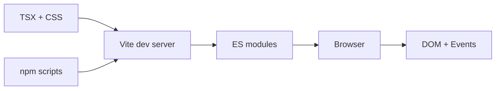
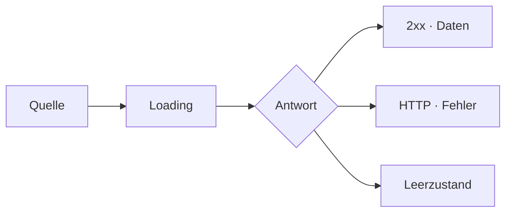
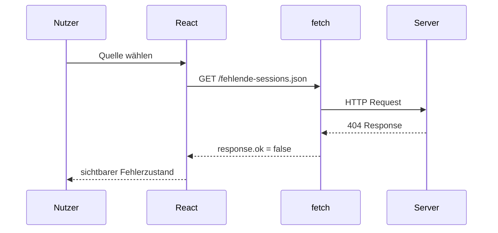

# Workshop: Moderne Web-Applikationen

## mit React und Material-UI in TypeScript

**EKON 30 · Düsseldorf, November 2026 · Harald Binkle**

<!--
Wir bauen heute gemeinsam eine Browser-App und ordnen die Web-Technologien ein: von Node.js, TypeScript und React über Material UI und REST-Daten bis zu Debugging, Wartbarkeit und Performance. Beispiele knüpfen an bekannte Muster aus der Desktopentwicklung an.
Quelle zur Session: https://entwickler-konferenz.de/frameworks-and-tools/workshop-moderne-web-applikationen-mit-react-19-und-material-ui-6-in-typescript
-->

---
title: Speaker
layout: intro
src: /special-slides/speaker.md

---

---
title: Vorbereitung
layout: default
hideInToc: true
---

# Vorbereitung: Übungsrepo

<div class="grid grid-cols-2 gap-10 items-center mt-6">

<div>

**Bitte mitbringen**

<v-clicks>

- Windows: PowerShell; macOS: Terminal (Git-/npm-Befehle sind identisch)
- Node.js 24+, npm und Git
- VS Code sowie einen aktuellen Browser
- Repository klonen und `npm install` ausführen

</v-clicks>

```powershell
git clone https://github.com/harrybin/ekon30-react-typescript-workshop.git
cd ekon30-react-typescript-workshop
npm.cmd install
npm.cmd run dev
```

**Repo:** [github.com/harrybin/ekon30-react-typescript-workshop](https://github.com/harrybin/ekon30-react-typescript-workshop)

**Demo Time:** Act *React-Workshop: Session-Katalog* · sieben Szenen

</div>

<div class="text-center">

<QRCode
  type="svg"
  :data="'https://github.com/harrybin/ekon30-react-typescript-workshop'"
  :dotsOptions="{ color: '#164e8a', type: 'extra-rounded', roundSize: false }"
  :backgroundOptions="{ color: '#ffffff' }"
  :width="220"
  :height="220"
/>

<p>Scannen, klonen, App starten</p>

</div>

</div>

<!--
Vorbereitung: Starterprojekt klonen, npm-Abhängigkeiten installieren und lokale App starten. Bei Setup-Problemen vorab den Workshop-README-Hinweisen folgen. macOS nutzt `npm install` und `npm run dev`; Windows folgt dem Repo-README mit `npm.cmd`. Die Moderation folgt dem Demo-Time-Act „React-Workshop: Session-Katalog“ im Repo-README.
Quellen: https://github.com/harrybin/ekon30-react-typescript-workshop · https://marketplace.visualstudio.com/items?itemName=eliostruyf.vscode-demo-time
-->

---
layout: cover
coverImage: msWebUiReact-strategic-answer.jpg
isDark: true
hideInToc: true
---

# Von der Desktop-App zur Browser-App

## Vertraute Konzepte, neue Laufzeit und Architektur

<v-clicks>

- Browser-App und Website unterscheiden
- TypeScript, React und Material UI einordnen
- eine testbare und wartbare App aufbauen

</v-clicks>

<!--
Die Herausforderung ist nicht nur JSX: Wir betrachten Browser-Laufzeit, Bundling, Komponenten, Datenfluss und die Unterschiede zu Desktop-UI.
-->

---
title: Sessionprofil
layout: image-right
background: msWebUiReact-decision-tree.jpg
hideInToc: true
---

# Für den Wechsel aus der Desktopentwicklung

<v-clicks>

- **Zielgruppe:** Entwickler:innen, besonders mit Desktop-UI-Erfahrung
- **Ergebnis:** strukturierte Browser-App mit typisierten Daten und Material UI
- **Stack:** TypeScript, React, Material UI, Node.js und Vite
- **Vorkenntnisse:** Programmierkenntnisse; HTML/CSS- oder React-Vorkenntnisse sind nicht nötig

</v-clicks>

<!--
Parallelen zu Desktopentwicklung erleichtern den Einstieg: UI-Komponenten, Properties, Events und State bleiben vertraut. Neu sind unter anderem Browser-Laufzeit, deklaratives Rendering und der Build-Prozess.
-->

---
title: Agenda
layout: default
hideInToc: true
---

# Vom Werkzeug zur Web-App

<v-clicks>

- Web-App vs. Website, VS Code und Node.js
- TypeScript: Types, Interfaces und Generics
- Funktionales React: Komponenten, Props und Lifecycle
- Material UI: Komponenten, Layout und Styling
- Hooks, State und React Context
- REST-Daten, Fetch API und optional AutoRest
- Debugging, Performance, Tests und Ausblick
- Gemeinsame Pausen

</v-clicks>

<!--
Pausen sind eingeplant. Vite ist der vorbereitete Bundler; webpack wird als Alternative eingeordnet. AutoRest, Tests mit Playwright und App-Konfiguration sind optionale Vertiefungen abhängig von Tempo und Vorkenntnissen. Das Starter-Repository wird vorab getestet.
-->

---
layout: chapter
background: msWebUiReact-crossroads.jpg
isDark: true
---

# 01 · Was steckt in einer Browser-App?

<!--
Webseite und Web-App unterscheiden sich in Interaktion, Zustand und Datenfluss. Die App läuft im Browser, wird aber typischerweise mit Node-basierten Werkzeugen entwickelt und gebündelt.
-->

---
title: Die Session-App
layout: image-right
background: msWebUiReact-demo1.jpg
---

# Ein roter Faden für die Übungen

<v-clicks>

- kleine browserbasierte Fachanwendung
- Datenmodell und UI-Komponenten schrittweise ergänzen
- Inhalte aus einer REST-Schnittstelle laden
- Build, Debugging und Erweiterbarkeit nachvollziehen

</v-clicks>

<!--
Ein kleines Konferenz- oder Katalogbeispiel dient als durchgehende App. Vorhandenen Starter zeigen: lauffähig, mit wenigen Daten und ohne versteckte fertige Übungen.
-->

---
title: Node.js und der Frontend-Werkzeugkasten
layout: image-right
background: msWebUiReact-tooling.jpg
---

# Entwickeln mit Node.js, bauen für den Browser

<v-clicks>

- Node.js führt Entwicklungs- und Build-Werkzeuge aus
- npm verwaltet Projektabhängigkeiten und Skripte
- Vite startet Dev-Server und bündelt die App
- Extensions ergänzen TypeScript, React und Browser-Debugging

</v-clicks>

<!--
Node.js ist hier zunächst die Werkzeug-Laufzeit, nicht automatisch der Server für die ausgelieferte Browser-App. Vite wird praktisch eingesetzt; webpack wird als verbreitete Alternative eingeordnet.
-->

---
title: Architektur · Code wird im Browser ausgeführt
layout: image-right
background: msWebUiReact-transfers.jpg
---

# Vom TypeScript-Modul zur Browser-Oberfläche



<v-clicks>

- Node.js startet die Werkzeuge; React läuft im Browser
- Dev-Server liefert Module und schnelle Aktualisierungen
- Produktion bündelt Dateien für statisches Hosting

</v-clicks>

<!--
Quellen: https://vite.dev/guide/ · https://react.dev/learn
-->

---
title: Tooling · npm-Skripte lesen
layout: default
---

# `package.json` ist der Projekt-Launcher

```json
{
  "scripts": {
    "dev": "vite --host 127.0.0.1",
    "build": "tsc -b && vite build",
    "preview": "vite preview --host 127.0.0.1"
  }
}
```

<v-clicks>

- `npm run dev`: lokaler Entwicklungsserver
- `npm run build`: zuerst TypeScript, danach Bundle
- `npm run preview`: lokales Gegenchecken des Builds

</v-clicks>

<!--
Im Workshop-Repo stehen diese Skripte in package.json. Windows PowerShell nutzt laut README `npm.cmd`; macOS verwendet `npm`. Quelle: https://github.com/harrybin/ekon30-react-typescript-workshop
-->

---
title: Tooling · Starten unter Windows
layout: image-left
background: msWebUiReact-tooling.jpg
---

# PowerShell: ein reproduzierbarer Start

```powershell
git clone https://github.com/harrybin/ekon30-react-typescript-workshop.git
cd ekon30-react-typescript-workshop
npm.cmd install
npm.cmd run dev
```

<v-clicks>

- `npm.cmd` umgeht eine mögliche Sperre für `npm.ps1`
- Vite zeigt die lokale URL im Terminal
- macOS: dieselben Befehle mit `npm`

</v-clicks>

<!--
Die Befehle entsprechen dem README des Workshop-Repositories. macOS-Alternative: `npm install` und `npm run dev`. Quelle: https://github.com/harrybin/ekon30-react-typescript-workshop#start-unter-windows
-->

---
title: Tooling · Entwicklung und Produktion
layout: default
---

# Dev-Server ≠ Produktionsserver

<div class="grid grid-cols-2 gap-8">
<div>

**Entwicklung**

- Modulserver auf `127.0.0.1`
- schnelle Feedbackschleife
- Debug-Quellcode

</div>
<div>

**Produktion**

- `npm run build`
- statische Dateien unter `dist/`
- Hosting/CDN liefert Assets aus

</div>
</div>

<v-click>

Prüffrage: Welche Datei muss geändert werden, wenn die API-URL in Produktion anders ist?

</v-click>

<!--
Quellen: https://vite.dev/guide/build.html · Workshop-Projekt: package.json und vite.config.ts.
-->

---
title: Übung 1 · Projekt starten und Umgebung verstehen
layout: image-left
background: msWebUiReact-tooling.jpg
---

# 20 Minuten · Vite und Debugging

<v-clicks>

- Starter installieren und Vite-Dev-Server starten
- Projektstruktur und npm-Skripte finden
- Browser-DevTools und VS-Code-Debugging öffnen
- **Ergebnis:** App lokal gestartet und Debugger einsatzbereit

</v-clicks>

**Repo-Übung:** [Tooling](https://github.com/harrybin/ekon30-react-typescript-workshop/blob/main/exercises/01-tooling.md)

<!--
Geführte Einrichtung: VS Code, Extensions, Node/npm-Skripte, Browser-Konsole und Breakpoints. Setup vorab vereinfachen, damit Teilnehmende nicht lange installieren müssen.
-->

---
title: TypeScript modelliert Datenverträge
layout: default
---

# TypeScript: JavaScript mit statischen Typen

```ts
interface Session {
  id: string;
  title: string;
  speaker: string;
  track: string;
}

type ApiResult<T> = {
  data: T;
  receivedAt: Date;
};
```

<v-click>

**Übung 2 · 35 Minuten:** `Session`-Interface, generischen API-Typ und typisierte Beispieldaten anlegen.

**Repo-Übung:** [TypeScript](https://github.com/harrybin/ekon30-react-typescript-workshop/blob/main/exercises/02-typescript.md)

</v-click>

<!--
Anhand des Beispieltyps Types, Interfaces und Generics erklären. Desktop-Parallele: Verträge für Daten zwischen UI und Services werden explizit. Danach ein Objekt typisieren und einen absichtlich fehlerhaften Wert vom TypeScript-Compiler finden lassen.
-->

---
title: TypeScript · Externe Daten sind unknown
layout: default
---

# Typen zur Laufzeit prüfen

```ts
const payload: unknown = await response.json()

if (!Array.isArray(payload) || !payload.every(isSession)) {
  throw new Error('Ungültige Session-Daten')
}
```

<v-clicks>

- `unknown` zwingt zu einer Prüfung vor dem Zugriff
- ein TypeScript-Interface validiert JSON nicht zur Laufzeit
- nach dem Guard ist `payload` sicher als `Session[]` nutzbar

</v-clicks>

<!--
Der Guard `isSession` ist in `workshop-demo/DemoApp.tsx` enthalten. Quellen: https://www.typescriptlang.org/docs/ · https://github.com/harrybin/ekon30-react-typescript-workshop/blob/main/workshop-demo/DemoApp.tsx
-->

---
title: TypeScript · Guards als Datenvertrag
layout: two-cols
---

# Ein Narrowing-Schritt nach dem anderen

```ts
function isSession(value: unknown): value is Session {
  if (typeof value !== 'object' || value === null) return false
  const item = value as Record<string, unknown>
  return ['id', 'title', 'speaker', 'track', 'startsAt']
    .every((key) => typeof item[key] === 'string')
}
```

::right::

<v-clicks>

- `unknown` an der Systemgrenze
- `typeof` und `null` filtern
- Guard-Prädikat sagt dem Compiler, was geprüft wurde

</v-clicks>

<!--
Kleiner Auszug aus der Referenzdemo. Die Prüfung deckt die gezeigten Pflichtfelder ab; für Produktionsdaten gehören Schema-Versionen und Domänenregeln dazu. Quelle: https://github.com/harrybin/ekon30-react-typescript-workshop/blob/main/workshop-demo/DemoApp.tsx
-->

---
title: TypeScript · Zustände als diskriminierte Union
layout: default
---

# Unmögliche Ladezustände vermeiden

```ts
type LoadState =
  | { status: 'loading' }
  | { status: 'error'; message: string }
  | { status: 'success'; sessions: Session[] }
```

<v-clicks>

- Fehlerzustand braucht eine Meldung
- Erfolgszustand trägt Daten
- `status` grenzt die erlaubten Felder ein

</v-clicks>

<!--
Genau dieses Union-Muster wird in `workshop-demo/DemoApp.tsx` eingesetzt. Quellen: https://www.typescriptlang.org/docs/handbook/2/narrowing.html · https://github.com/harrybin/ekon30-react-typescript-workshop/blob/main/workshop-demo/DemoApp.tsx
-->

---
title: TypeScript · Generics bewahren Beziehungen
layout: default
---

# Ein API-Wrapper bleibt für `T` spezifisch

```ts
type ApiResult<T> = {
  data: T
  receivedAt: Date
}

const result: ApiResult<Session[]> = {
  data: sessions,
  receivedAt: new Date(),
}
```

<v-clicks>

- `T` ist ein Platzhalter, kein `any`
- `ApiResult<Session[]>` hält die Daten präzise
- Funktionen können denselben Vertrag wiederverwenden

</v-clicks>

<!--
`ApiResult<T>` entspricht dem Startertyp `src/types.ts`. Quelle: https://github.com/harrybin/ekon30-react-typescript-workshop/blob/main/src/types.ts
-->

---
title: TypeScript · Übungsauftrag
layout: image-right
background: msWebUiReact-demo1.jpg
---

# Kleine Änderungen, sofort Feedback

<v-clicks>

- `startsAt` absichtlich als Zahl einsetzen
- Compilerfehler lesen statt wegcasten
- eine Session-Eigenschaft ergänzen
- ein fehlerhaftes JSON mit `unknown` abweisen

</v-clicks>

**Check:** Welche Fehler findet der Compiler, welche erst der Browser?

<!--
Angelehnt an `exercises/02-typescript.md`; externe JSON-Daten sind nicht durch Interfaces geprüft. Quelle: https://github.com/harrybin/ekon30-react-typescript-workshop/blob/main/exercises/02-typescript.md
-->

---
title: React entwickelt UI deklarativ
layout: image-right
background: msWebUiReact-transfers.jpg
---

# Komponenten, Props und Rendering

<div class="ekon30-flow ekon30-flow--five">
  <div v-click class="ekon30-flow__step">
    <strong>Props + State</strong>
    <p>Daten und Callbacks gehen in die Komponente</p>
  </div>
  <div v-click class="ekon30-flow__step">
    <strong>Komponente</strong>
    <p>Beschreibt UI als Funktion ihrer Daten</p>
  </div>
  <div v-click class="ekon30-flow__step">
    <strong>Browser-UI</strong>
    <p>Zeigt den gerenderten Stand</p>
  </div>
  <div v-click class="ekon30-flow__step">
    <strong>Event</strong>
    <p>Callback löst eine State-Änderung aus</p>
  </div>
  <div v-click class="ekon30-flow__step">
    <strong>React-Render</strong>
    <p>Aktualisiert die betroffenen Teile</p>
  </div>
</div>

<!--
Desktop-Parallele: Komponenten und Ereignisse sind vertraut; anders ist, dass das UI deklarativ aus aktuellem State abgeleitet wird, statt imperative Controls direkt zu verändern.
-->

---
title: Komponenten bilden die UI
layout: image-left
background: msWebUiReact-transfers.jpg
---

# Zerlegen nach Verantwortung

<v-clicks>

- `AppShell`: Navigation und Seitenrahmen
- `SessionList`: Daten anzeigen
- `SessionCard`: eine Session darstellen
- `SessionForm`: Eingaben und Aktion

</v-clicks>

<!--
Analogie zu vertrauten UI-Frameworks: Komponenten kapseln Darstellung und Verhalten, aber nicht jede Komponente braucht eigenen State.
-->

---
title: Komponenten · Props sind Eingaben
layout: default
---

# Eine Karte erhält Daten statt sie zu laden

```tsx
function SessionCard({ session }: { session: Session }) {
  return (
    <Card>
      <CardContent>
        <Typography variant="h6">{session.title}</Typography>
        <Typography>{session.speaker}</Typography>
      </CardContent>
    </Card>
  )
}
```

<v-clicks>

- Props sind readonly Eingaben der Komponente
- Typen machen den Vertrag beim Aufruf sichtbar
- Darstellung und Datenbeschaffung bleiben trennbar

</v-clicks>

<!--
In der Demo wird `SessionCard` aus einem typisierten `Session`-Objekt gerendert. Dieses MUI-Beispiel zeigt dieselbe Trennung in Kurzform. Quellen: https://react.dev/learn/passing-props-to-a-component · https://github.com/harrybin/ekon30-react-typescript-workshop/blob/main/workshop-demo/DemoApp.tsx
-->

---
title: Komponenten · Events sind Callbacks
layout: default
---

# Vom Klick zur Änderung

```tsx
<Button
  aria-pressed={selected}
  onClick={() => toggle(session.id)}
>
  {selected ? 'Aus Merkliste entfernen' : 'Merken'}
</Button>
```

<v-clicks>

- Kind meldet ein Ereignis per Callback
- der State-Eigentümer entscheidet über die Änderung
- `aria-pressed` macht den Toggle-Zustand zugänglich

</v-clicks>

<!--
Der Button stammt aus `SessionCard` in der Referenzdemo. Quellen: https://react.dev/learn/responding-to-events · https://github.com/harrybin/ekon30-react-typescript-workshop/blob/main/workshop-demo/DemoApp.tsx
-->

---
title: Rendering · Keys geben Identität
layout: default
---

# Listen brauchen stabile Schlüssel

```tsx
{sessions.map((session) => (
  <SessionCard key={session.id} session={session} />
))}
```

<v-clicks>

- Key ist Geschwister-Identität für React
- fachliche ID statt Array-Index
- keine zufälligen Keys während des Renderns erzeugen

</v-clicks>

<!--
Der Starter rendert `Card key={session.id}` in `src/App.tsx`; die Demo nutzt `session.id` ebenfalls für Liste und Merkliste. Quelle: https://react.dev/learn/rendering-lists
-->

---
title: State · Updates sind unveränderlich
layout: default
---

# State-Update aus dem vorherigen Wert

```ts
const toggle = (id: string) => setIds((previous) =>
  previous.includes(id)
    ? previous.filter((item) => item !== id)
    : [...previous, id],
)
```

<v-clicks>

- funktionales Update liest den aktuellen Vorzustand
- `filter` und Spread erzeugen ein neues Array
- keine Mutation wie `ids.push(id)`

</v-clicks>

<!--
Dies ist der Toggle aus der Referenzdemo. Quelle: https://github.com/harrybin/ekon30-react-typescript-workshop/blob/main/workshop-demo/DemoApp.tsx
-->

---
title: React · Magic Move im State-Update
layout: default
---

# Vom Klick zum sichtbaren Ergebnis

````md magic-move
```tsx
const [ids, setIds] = useState<string[]>([])
```
```tsx
const toggle = (id: string) => {
  setIds((previous) => [...previous, id])
}
```
```tsx
const toggle = (id: string) => setIds((previous) =>
  previous.includes(id)
    ? previous.filter((item) => item !== id)
    : [...previous, id],
)
```
````

<!--
Magic Move zeigt die tatsächliche Lösungsentwicklung: State, einfaches Anhängen, dann korrektes Umschalten. Quelle: https://github.com/harrybin/ekon30-react-typescript-workshop/blob/main/workshop-demo/DemoApp.tsx
-->

---
title: Hooks statt Lifecycle-Methoden
layout: image-left
background: msWebUiReact-state-management.jpg
---

# Lifecycle-Konzepte funktional abbilden

<v-clicks>

- `useState` für lokalen State
- `useEffect` für Synchronisation mit externen Systemen
- Props und State steuern erneutes Rendern
- Effects gezielt einsetzen, nicht als Ersatz für Datenfluss

</v-clicks>

<!--
Lifecycle Methods als historisches Klassenkomponenten-Modell erwähnen, aber den Workshop konsequent mit funktionalen Komponenten und Hooks gestalten. Mount/Update/Unmount nicht mechanisch auf mehrere Effects übertragen.
-->

---
title: React · `useEffect` synchronisiert außen
layout: default
---

# Effect nur für externe Systeme

```tsx
useEffect(() => {
  const controller = new AbortController()
  void loadSessions({ signal: controller.signal })
  return () => controller.abort()
}, [source])
```

<v-clicks>

- Effect folgt dem Wert `source`
- Cleanup bricht veraltete Requests beim Wechsel ab
- abgeleitete Werte gehören direkt in Render-Berechnungen

</v-clicks>

<!--
Der Fetch-Effect der Demo nutzt `AbortController` und `source` als Dependency. Quelle: https://react.dev/reference/react/useEffect · https://github.com/harrybin/ekon30-react-typescript-workshop/blob/main/workshop-demo/DemoApp.tsx
-->

---
title: React · Dependency-Array verstehen
layout: default
---

# Dependencies beschreiben verwendete Werte

<v-clicks>

- jeder reaktive Wert im Effect muss berücksichtigt werden
- ein leeres Array heißt nicht „Effect ist immer richtig“
- fehlende Dependencies erzeugen veraltete Closures
- bei Datenladen: Abbruch/Antwortreihenfolge mitdenken

</v-clicks>

**Debug-Frage:** Was passiert, wenn `source` wechselt, bevor die erste Antwort eintrifft?

<!--
Quellen: https://react.dev/learn/lifecycle-of-reactive-effects · https://react.dev/reference/react/useEffect
-->

---
title: React 19 · `use` liest Ressourcen
layout: default
---

# Promise- oder Context-Wert im Render lesen

```tsx
function SessionDetails({ sessionPromise }: Props) {
  const session = use(sessionPromise)
  return <h2>{session.title}</h2>
}
```

<v-clicks>

- `use(promise)` suspendiert bis der Wert verfügbar ist
- Promise muss stabil sein, etwa aus Framework/Cache
- `<Suspense>` zeigt Lade-UI; Fehler gehören zum Error Boundary

</v-clicks>

<!--
React-19-Transferfolie; nicht Teil der Workshop-Referenzdemo, deren Datenladen `useEffect` plus Fetch nutzt. Quellen: https://react.dev/reference/react/use · https://react.dev/reference/react/Suspense
-->

---
title: React 19 · `useActionState`
layout: default
---

# Formularaktion mit Rückmeldung

```tsx
async function saveSession(_previous: Result, formData: FormData) {
  return api.save({ title: String(formData.get('title') ?? '') })
}

const [result, dispatch, pending] =
  useActionState(saveSession, initialResult)
```

<v-clicks>

- Action verarbeitet Formulardaten und gibt neuen State zurück
- `pending` kann Submit-Feedback steuern
- Framework/Server-Verhalten ist nicht automatisch enthalten

</v-clicks>

<!--
React-19-Einordnung, kein Bestandteil des Demo-Projekts. Im Workshop als Transferfrage behandeln; Beispiel benötigt eine passende `api.save`-Implementierung. Quelle: https://react.dev/reference/react/useActionState
-->

---
title: React 19 · Optimistic UI
layout: default
---

# Sofort reagieren, später bestätigen

```tsx
const [optimisticIds, addOptimistic] =
  useOptimistic(ids, (current, id: string) => [...current, id])

async function saveFavorite(id: string) {
  addOptimistic(id)
  await persistFavorite(id)
}
```

<v-clicks>

- optimistische Ansicht ist temporär
- Server-/Persistenzfehler müssen weiterhin behandelt werden
- keine zweite dauerhafte Wahrheit neben dem echten State

</v-clicks>

<!--
React-19-Transferfolie, nicht Bestandteil der Demo-Merkliste (dort wird lokaler State verwendet). Quellen: https://react.dev/reference/react/useOptimistic · https://react.dev/blog/2024/12/05/react-19
-->

---
title: React · Übungs-Checkpoint
layout: image-left
background: msWebUiReact-state-management.jpg
---

# Zeichne den Datenfluss deiner Komponente

```text
App state → props → SessionCard
     ↑                    │
     └──── callback ←─────┘
```

<v-clicks>

- Wo liegt der State?
- Wer darf ihn ändern?
- Welche UI wird daraus neu berechnet?

</v-clicks>

<!--
Als kurze Partnerübung nach `exercises/03-components-hooks.md`. Quelle: https://github.com/harrybin/ekon30-react-typescript-workshop/blob/main/exercises/03-components-hooks.md
-->

---
title: Übung 3 · Komponente und Hook
layout: image-left
background: msWebUiReact-demo1.jpg
---

# 20 Minuten · React-Grundlagen anwenden

<v-clicks>

- `SessionCard` aus typisierten Props erstellen
- lokale Auswahl mit `useState` abbilden
- State-Änderung und erneutes Rendering beobachten
- **Ergebnis:** interaktive Komponente ohne imperative DOM-Manipulation

</v-clicks>

**Repo-Übung:** [Komponenten & Hooks](https://github.com/harrybin/ekon30-react-typescript-workshop/blob/main/exercises/03-components-hooks.md)

<!--
Geführt: eine Komponente bauen, Event-Handler ergänzen und mit React DevTools/Browser-Tools untersuchen.
-->

---
layout: chapter
background: msWebUiReact-crossroads.jpg
isDark: true
---

# 02 · Material UI und State

<!--
Material UI bietet einen produktiven UI-Baukasten. Danach organisieren wir Komponenten-State und geteilte Daten mit Hooks und Context.
-->

---
title: Material UI als konsistenter Baukasten
layout: image-right
background: msWebUiReact-fluent-ui.jpg
---

# Design-Tokens statt CSS-Wildwuchs

<v-clicks>

- Theme für Farbe, Typografie und Abstände
- Layout mit Grid/Stack und responsiven Breakpoints
- Komponenten passend zur Aufgabe wählen
- CSS gezielt dort ergänzen, wo es wirklich nötig ist

</v-clicks>

<!--
Material UI bietet vorgefertigte Komponenten, Layout-Primitives und Theme-Optionen. Ziel ist eine brauchbare Oberfläche, ohne jedes Detail mit handgeschriebenem CSS zu lösen. Für dieses EKON-Angebot Material UI 6 verwenden.
-->

---
title: MUI · Theme zentral konfigurieren
layout: default
---

# Tokens statt verstreuter Einzelwerte

```tsx
const theme = createTheme({
  palette: {
    primary: { main: '#164e8a' },
    background: { default: '#f6f8fb' },
  },
  shape: { borderRadius: 12 },
})

<ThemeProvider theme={theme}>
  <CssBaseline />
  <App />
</ThemeProvider>
```

<v-clicks>

- ThemeProvider stellt Tokens im Komponentenbaum bereit
- `CssBaseline` vereinheitlicht Browser-Defaults
- Theme-Werte zentral ändern, nicht in jeder Karte

</v-clicks>

<!--
MUI-6-kompatibles Standardmuster; die Referenzdemo importiert MUI-Komponenten und kann im Workshop-Exercise um ThemeProvider erweitert werden. Quellen: https://mui.com/material-ui/customization/theming/ · https://mui.com/material-ui/react-css-baseline/
-->

---
title: MUI 6 · Responsive Grid
layout: default
---

# Breakpoints sind Layoutregeln

```tsx
<Grid container spacing={2}>
  <Grid size={{ xs: 12, md: 6 }}>
    <SessionCard session={session} />
  </Grid>
</Grid>
```

<v-clicks>

- schmal: Karte belegt die ganze Breite
- ab `md`: zwei Spalten möglich
- MUI 6 Grid verwendet `size` statt altem `item xs`

</v-clicks>

<!--
Die genaue Grid-API gegen die festgelegte MUI-6-Version prüfen: Workshop package.json pinnt `@mui/material` auf ^6.5.0. Quellen: https://mui.com/material-ui/react-grid/ · https://mui.com/material-ui/migration/upgrade-to-v6/
-->

---
title: MUI · `sx` für lokale Ausnahmen
layout: two-cols
---

# Systemprop oder Theme?

```tsx
<Container maxWidth="md" sx={{ py: 4 }}>
  <Stack spacing={2}>{children}</Stack>
</Container>
```

::right::

<v-clicks>

- `sx`: kurze, lokale responsive Styles
- Theme: wiederverwendbare Designentscheidung
- CSS: komplexe Selektoren und Animationen

</v-clicks>

<!--
`Container` und `Stack` entsprechen dem Startercode in `src/App.tsx`. Quelle: https://github.com/harrybin/ekon30-react-typescript-workshop/blob/main/src/App.tsx
-->

---
title: MUI · Interaktionen zugänglich machen
layout: default
---

# Bedienbar mit Maus, Tastatur und Screenreader

<v-clicks>

- Eingaben brauchen sichtbare Labels
- Toggle-Zustand mit `aria-pressed` kommunizieren
- Fokusindikator nicht entfernen
- Farbkontrast und Touch-Ziel prüfen
- semantische Überschriftenhierarchie erhalten

</v-clicks>

<!--
`TextField`-Labels und `aria-pressed` kommen in der Demo vor. Quellen: https://mui.com/material-ui/react-text-field/ · https://www.w3.org/WAI/WCAG22/quickref/
-->

---
title: MUI · Übung in zwei Viewports
layout: image-right
background: msWebUiReact-tooling.jpg
---

# Checkpoint: schmal und breit

<v-clicks>

- Browser auf ca. 390 px und danach Desktopbreite stellen
- horizontales Scrollen und abgeschnittene Controls finden
- Breakpoint-Regel im Code lokalisieren
- eine Änderung vor dem nächsten Screenshot formulieren

</v-clicks>

<!--
Angelehnt an `exercises/04-material-ui.md`: responsive Oberfläche in schmaler und breiter Ansicht prüfen. Quelle: https://github.com/harrybin/ekon30-react-typescript-workshop/blob/main/exercises/04-material-ui.md
-->

---
title: Material UI für Komponenten, Layout und Styling
layout: image-right
background: msWebUiReact-summary.jpg
---

# Komponenten, Layout und Styling

<v-clicks>

- MUI-Komponenten für wiederkehrende UI-Muster
- Stack/Grid und responsive Breakpoints
- Theme für konsistente Farben und Typografie
- CSS-Fallstricke beim Wechsel vom Desktop ins Web

</v-clicks>

<!--
Desktop-Analogie: Component Library und Theme entsprechen einem UI-Baukasten mit zentralen Stilvorgaben. Unterschiede im CSS-Layoutmodell und responsiven Verhalten sichtbar machen.
-->

---
title: Live-Demo · Ein Theme in zwei Viewports
layout: image-right
background: msWebUiReact-tooling.jpg
---

# Responsive Layout live vergleichen

<v-clicks>

- dieselbe MUI-Oberfläche in schmaler und breiter Ansicht öffnen
- Breakpoint und Layout-Komponente im Code zeigen
- Ergebnis im Browser statt nur im Stylesheet beurteilen

</v-clicks>

<!--
Diese kurze Vorführung gehört in die vorhandene Demo-Zeit von Übung 4. Das Team ändert danach selbst die responsive MUI-Oberfläche und prüft beide Viewports.
-->

---
title: Übung 4 · Responsive MUI-Oberfläche
layout: image-left
background: msWebUiReact-tooling.jpg
---

# 40 Minuten · konsistent statt CSS-intensiv

<v-clicks>

- App-Bar, Filterbereich und Ergebnisliste mit MUI bauen
- Theme und responsive Layout-Komponenten anwenden
- mobile und breite Ansicht vergleichen
- **Ergebnis:** nutzbare Oberfläche mit wenig eigenem CSS

</v-clicks>

**Repo-Übung:** [Material UI](https://github.com/harrybin/ekon30-react-typescript-workshop/blob/main/exercises/04-material-ui.md)

<!--
Geführt: Komponenten zuerst, dann Layout und Breakpoints. CSS-Fallstricke zeigen, die beim Wechsel von Desktop-Layouts zu responsiven Browser-Layouts häufig auftreten.
-->

---
title: State teilen mit React Context
layout: image-right
background: msWebUiReact-state-management.jpg
---

# Context für gemeinsam benötigte Daten

<v-clicks>

- lokaler State bleibt nah an der Komponente
- Context vermeidet unnötiges Weiterreichen durch viele Ebenen
- Hooks kapseln wiederverwendbares Verhalten
- State-Libraries erst bei konkretem Bedarf

</v-clicks>

<!--
Verweis auf das bestehende React-State-Management-Material im Repository. Context ist kein universeller Ersatz für Server-State- oder State-Management-Lösungen.
-->

---
title: State · Lokal, gemeinsam, abgeleitet
layout: default
---

# Erst klassifizieren, dann platzieren

<div class="grid grid-cols-3 gap-4">
<div v-click class="p-4 rounded-xl bg-blue-900/20">
<strong>Lokal</strong><p>Suchfeldwert</p>
</div>
<div v-click class="p-4 rounded-xl bg-purple-900/20">
<strong>Gemeinsam</strong><p>Merkliste</p>
</div>
<div v-click class="p-4 rounded-xl bg-emerald-900/20">
<strong>Abgeleitet</strong><p>gefilterte Sessions</p>
</div>
</div>

<!--
Beispiele folgen den Übungen 5 und 6: Filter-State lokal, Merkliste als Context, Trefferliste aus Inputdaten ableiten. Quelle: https://github.com/harrybin/ekon30-react-typescript-workshop/blob/main/exercises/05-context.md
-->

---
title: Context · Provider und sicherer Hook
layout: default
---

# Context-Zugriff typisieren

```tsx
const FavoritesContext = createContext<Favorites | null>(null)

function useFavorites() {
  const context = useContext(FavoritesContext)
  if (!context) throw new Error('FavoritesContext benötigt einen Provider')
  return context
}
```

<v-clicks>

- `null` macht fehlenden Provider sichtbar
- eigener Hook bündelt den Guard
- Provider umschließt nur den benötigten Teilbaum

</v-clicks>

<!--
Dieser Context-Hook ist aus `workshop-demo/DemoApp.tsx`. Quellen: https://react.dev/learn/passing-data-deeply-with-context · https://github.com/harrybin/ekon30-react-typescript-workshop/blob/main/workshop-demo/DemoApp.tsx
-->

---
title: Context · Änderungen bewusst begrenzen
layout: default
---

# Context ist kein globaler Cache

<v-clicks>

- Context für Werte, die mehrere Ebenen benötigen
- häufig wechselnde Werte können viele Verbraucher aktualisieren
- Context nicht pro Feld reflexhaft einsetzen
- erst messen, dann Provider aufteilen oder State-Tool wählen

</v-clicks>

<!--
Die Merkliste ist ein überschaubares Context-Beispiel. React Context ersetzt nicht automatisch Server-State- oder Data-Fetching-Lösungen. Quellen: https://react.dev/reference/react/useContext · https://react.dev/learn/scaling-up-with-reducer-and-context
-->

---
title: State · Abgeleitete Trefferliste
layout: default
---

# Ergebnis-State nicht doppelt speichern

```tsx
const visible = sessions.filter((session) =>
  session.title.toLocaleLowerCase().includes(query.toLocaleLowerCase())
  && (!track || session.track === track),
)
```

<v-clicks>

- Quelle bleibt `sessions`
- Filterwerte bleiben klein und unabhängig
- bei Änderungen rechnet React die sichtbare Liste neu

</v-clicks>

<!--
Die Filterlogik entspricht der Demo. Workshop-Übung sagt explizit: Ergebnis ableiten statt Ergebnis-State duplizieren. Quelle: https://github.com/harrybin/ekon30-react-typescript-workshop/blob/main/workshop-demo/DemoApp.tsx
-->

---
title: Übung 5 · Hooks und Context
layout: image-left
background: msWebUiReact-demo1.jpg
---

# 35 Minuten · Zustand sauber organisieren

<v-clicks>

- Such- und Trackfilter mit Hooks ergänzen
- gemeinsam benötigte Auswahl über Context teilen
- unnötige und doppelte State-Werte vermeiden
- **Ergebnis:** Filter und Merkliste mit klarer State-Verantwortung

</v-clicks>

**Repo-Übung:** [React Context](https://github.com/harrybin/ekon30-react-typescript-workshop/blob/main/exercises/05-context.md)

<!--
Checkpoint: Teilnehmende erklären, welcher State lokal, abgeleitet oder gemeinsam genutzt wird. Bei Zeit einen Effect für eine externe Synchronisation demonstrieren.
-->

---
layout: chapter
background: msWebUiReact-mobile-push.jpg
isDark: true
---

# 03 · Daten, Debugging und Qualität

<!--
Mit Datenzugriff wird die Browser-App zu einer realistischen Client-Anwendung. Lade-, Erfolgs- und Fehlerzustände sind Bestandteil der UI.
-->

---
title: Daten abrufen mit Fetch
layout: image-right
background: msWebUiReact-demo1.jpg
---

# REST-Daten in den Komponentenfluss holen

<v-clicks>

- Browser `fetch`-API für HTTP-Aufrufe
- JSON-Antworten in TypeScript-Typen überführen
- Laden, Fehler und leere Ergebnisse sichtbar machen
- HTTP-Fehler explizit behandeln

</v-clicks>

<!--
`fetch` weist bei HTTP 4xx/5xx nicht automatisch ein Promise zurück: Response.ok prüfen. TypeScript-Typen validieren Laufzeitdaten nicht von selbst; API-Antworten als externe Eingabe behandeln.
-->

---
title: Live-Demo · Vom Request zum UI-Zustand
layout: default
---

# Antwort, Fehler und Ladezustand gehören zusammen

<div class="ekon30-flow ekon30-flow--four">
  <div v-click class="ekon30-flow__step">
    <strong>Request</strong>
    <p>URL und Status im Network-Panel prüfen</p>
  </div>
  <div v-click class="ekon30-flow__step">
    <strong>Response</strong>
    <p>`response.ok` und JSON-Form kontrollieren</p>
  </div>
  <div v-click class="ekon30-flow__step">
    <strong>UI-Zustand</strong>
    <p>Loading, Erfolg oder Fehler sichtbar machen</p>
  </div>
  <div v-click class="ekon30-flow__step">
    <strong>Wiederholen</strong>
    <p>Erfolgs- und Fehlerpfad testen</p>
  </div>
</div>

<!--
Diese kurze Vorführung gehört in die bestehende Zeit von Übung 6. Mit dem vorbereiteten Endpoint oder Mock arbeiten, damit CORS oder Netzverfügbarkeit nicht den Ablauf blockieren.
-->

---
title: Übung 6 · REST-Daten und UI-Zustände
layout: image-left
background: msWebUiReact-mobile-push.jpg
---

# 30 Minuten · von HTTP zu gerenderten Daten

<v-clicks>

- Sessions über die Browser-Fetch-API laden
- Loading-, Fehler- und Erfolgszustand darstellen
- typisierte Daten an die Komponenten weiterreichen
- **Ergebnis:** App zeigt echte oder lokal simulierte REST-Daten

</v-clicks>

**Repo-Übung:** [Fetch](https://github.com/harrybin/ekon30-react-typescript-workshop/blob/main/exercises/06-fetch.md)

<!--
Geführt: vorbereiteten API-Endpunkt oder Mock verwenden, damit Netz-/CORS-Probleme nicht die Übung blockieren. Im Debugger Request, Status und Response prüfen.
-->

---
title: Fetch · Request und UI-Zustand
layout: default
---

# Ein Request ist eine kleine Zustandsmaschine



<!--
Die Referenzdemo hat die Zustände `loading`, `error` und `success`; Fetch-Szenen demonstrieren Erfolg, leere Daten und 404. Quelle: https://github.com/harrybin/ekon30-react-typescript-workshop/blob/main/workshop-demo/DemoApp.tsx
-->

---
title: Fetch · HTTP-Status ist explizit
layout: default
---

# `fetch` wirft nicht automatisch bei 404

```ts
const response = await fetch(url, {
  signal: controller.signal,
  headers: { Accept: 'application/json' },
})
if (!response.ok) throw new Error(`HTTP ${response.status}`)
const data: unknown = await response.json()
```

<v-clicks>

- Netzwerkfehler: Promise wird abgelehnt
- HTTP 404: Response kommt normal zurück
- `response.ok` und JSON-Form getrennt prüfen

</v-clicks>

<!--
Direkter Auszug aus dem Demo-Fetch. Quelle: https://github.com/harrybin/ekon30-react-typescript-workshop/blob/main/workshop-demo/DemoApp.tsx · https://developer.mozilla.org/docs/Web/API/Fetch_API
-->

---
title: Fetch · Sequenz vom Klick zum DOM
layout: default
---

# Wo lässt sich ein 404 untersuchen?



<!--
Die Fehlerszene der Referenzdemo ruft absichtlich `/fehlende-sessions.json` auf. Quelle: https://github.com/harrybin/ekon30-react-typescript-workshop/blob/main/workshop-demo/DemoApp.tsx
-->

---
title: Fetch · Cleanup verhindert veraltete Antworten
layout: default
---

# Request beim Quellenwechsel abbrechen

```tsx
useEffect(() => {
  const controller = new AbortController()
  void loadSessions(source, controller.signal)
  return () => controller.abort()
}, [source])
```

<v-clicks>

- `signal` an `fetch` weiterreichen
- Cleanup läuft beim Wechsel und Unmount
- Abbruch nicht als sichtbaren Fehler darstellen

</v-clicks>

<!--
Der Demo-Catch prüft `controller.signal.aborted`, bevor er einen Fehlerzustand setzt. Quellen: https://developer.mozilla.org/docs/Web/API/AbortController · https://github.com/harrybin/ekon30-react-typescript-workshop/blob/main/workshop-demo/DemoApp.tsx
-->

---
title: Fetch · Drei Demo-Pfade
layout: image-right
background: msWebUiReact-demo1.jpg
---

# In Demo Time dieselbe UI prüfen

<v-clicks>

- **Erfolg:** `/sessions.json` → Karten
- **Leer:** `/empty-sessions.json` → leerer Zustand
- **Fehler:** fehlende Datei → HTTP 404

</v-clicks>

**Live-Act:** *React-Workshop: Session-Katalog* · Referenz-App: `/workshop-demo/`

<!--
Im README steht, den laufenden Vite-Devserver unter `/workshop-demo/` zu öffnen. Demo Time führt durch sieben Szenen; der Fetch-Act visualisiert die drei Endpunkte. Quelle: https://github.com/harrybin/ekon30-react-typescript-workshop#demo-time-für-den-workshop
-->

---
title: Fetch · Leerer Zustand ist kein Fehler
layout: default
---

# Erfolg kann null Treffer bedeuten

```tsx
{visible.length === 0 && (
  <Typography>Keine Sessions gefunden.</Typography>
)}
```

<v-clicks>

- Request erfolgreich, Array aber leer
- Filter kann ebenfalls null Treffer liefern
- leere UI erklärt, was der nächste Schritt ist

</v-clicks>

<!--
Die Demo zeigt „Keine Sessions gefunden.“ separat vom Fehlerpfad. Quelle: https://github.com/harrybin/ekon30-react-typescript-workshop/blob/main/workshop-demo/DemoApp.tsx
-->

---
title: REST-Clients und AutoRest
layout: image-right
background: msWebUiReact-tooling.jpg
---

# Von Hand geschrieben bis generiert

<v-clicks>

- `fetch` eignet sich für den Einstieg und kleine Clients
- AutoRest kann aus API-Beschreibungen Clients erzeugen
- generierter Code spart Routine, ersetzt aber kein API-Verständnis
- API-Vertrag, Fehlerfälle und Versionierung bleiben wichtig
- **Repo-Vertiefung:** [Optionale Übungen](https://github.com/harrybin/ekon30-react-typescript-workshop/blob/main/exercises/optional.md)

</v-clicks>

<!--
AutoRest ist ein optionaler Überblick oder eine vorbereitete Demo: OpenAPI-Beschreibung zeigen und generierte Typen/Clientmethoden nachvollziehen. Nur vertiefen, wenn Zeit und Setup passen.
-->

---
title: Fallstricke und Performance
layout: image-left
background: msWebUiReact-css-challenge.png
---

# Erst messen, dann optimieren

<v-clicks>

- unnötige Renders und zu große Komponenten erkennen
- `memo`/Memoization nicht reflexartig einsetzen
- Listen mit stabilen Keys rendern
- Netzwerk, Bundle-Größe und UI getrennt untersuchen
- **Repo-Vertiefung:** [Optionale Übungen](https://github.com/harrybin/ekon30-react-typescript-workshop/blob/main/exercises/optional.md)

</v-clicks>

<!--
Do's and Don'ts mit React DevTools und Browser Performance Panel besprechen. Vor Optimierung einen konkreten Engpass reproduzieren und messen.
-->

---
title: API-Vertrag · OpenAPI lesen
layout: default
---

# Der Client sollte nicht raten

<v-clicks>

- Methode und Pfad aus dem Vertrag
- Request-/Response-Schema ansehen
- optionale und nullable Felder unterscheiden
- Statuscodes als erwartbare Ergebnisse behandeln

</v-clicks>

**Repo:** `spec/openapi.yaml` · AutoRest bleibt optionale Vertiefung

<!--
Das Workshop-Repo enthält `spec/openapi.yaml`; AutoRest sowie generierter Client sind ausdrücklich nicht vorinstalliert. Quelle: https://github.com/harrybin/ekon30-react-typescript-workshop/blob/main/spec/openapi.yaml · https://github.com/harrybin/ekon30-react-typescript-workshop/blob/main/exercises/optional.md
-->

---
title: Konfiguration · Frontend-Werte sind öffentlich
layout: default
---

# API-Basis-URL ohne Geheimnisse

```ts
const apiBaseUrl = import.meta.env.VITE_API_BASE_URL
if (!apiBaseUrl) {
  throw new Error('VITE_API_BASE_URL ist nicht konfiguriert')
}
```

<v-clicks>

- `VITE_`-Werte werden in den Client-Build eingebettet
- niemals Token, Passwort oder privaten Schlüssel dort ablegen
- dev, test und production getrennt konfigurieren

</v-clicks>

<!--
Optionale Übertragung auf die App-Konfiguration im Workshop: ein Browser-Bundle kann nicht geheime Konfiguration verbergen. Quelle: https://vite.dev/guide/env-and-mode
-->

---
title: Debugging · Dem Request folgen
layout: default
---

# DevTools: vom UI bis zur Antwort

<div class="ekon30-flow ekon30-flow--four">
  <div v-click class="ekon30-flow__step">
    <strong>Network</strong><p>Pfad, Status, Timing</p>
  </div>
  <div v-click class="ekon30-flow__step">
    <strong>Response</strong><p>JSON und Header</p>
  </div>
  <div v-click class="ekon30-flow__step">
    <strong>Sources</strong><p>Breakpoint im Catch</p>
  </div>
  <div v-click class="ekon30-flow__step">
    <strong>React</strong><p>State und Props</p>
  </div>
</div>

<!--
Die Schritte beziehen sich auf die Browser-Debugging-Übung und die Fetch-Demo. Quelle: https://github.com/harrybin/ekon30-react-typescript-workshop/blob/main/exercises/01-tooling.md
-->

---
title: Qualität · Testfälle aus dem Verhalten
layout: default
---

# Drei Inputs, drei sichtbare Ergebnisse

<v-clicks>

- gültige Daten → Sessions werden gerendert
- leeres Array → leerer Zustand, kein Fehlerbanner
- 404 / ungültiges JSON → verständliche Fehlermeldung
- Suche/Trackfilter → Trefferliste passt sich an

</v-clicks>

<!--
Testideen für die optionale Browser-Testvertiefung. Playwright ist im Repo nicht installiert; `exercises/optional.md` beschreibt das als Setup-Aufgabe. Quelle: https://github.com/harrybin/ekon30-react-typescript-workshop/blob/main/exercises/optional.md
-->

---
title: Performance · Erst messen
layout: default
---

# Welche Messung beantwortet welche Frage?

<v-clicks>

- React DevTools: welche Komponente rendert?
- Performance-Panel: wo geht Zeit verloren?
- Network: API-Latenz oder Payloadgröße?
- Build-Ausgabe: wie groß ist das Client-Bundle?

</v-clicks>

**Regel:** Erst Engpass reproduzieren, dann eine Änderung messen.

<!--
Die optionale Übung empfiehlt Messung vor Optimierung und nennt Browser-Performance. Quellen: https://react.dev/learn/react-developer-tools · https://developer.chrome.com/docs/devtools/performance/
-->

---
title: Performance · Memoisierung ist kein Ziel
layout: default
---

# `memo` erst nach einem Befund

<v-clicks>

- unnötige Renderkosten konkret beobachten
- Props-Identität und teure Berechnung unterscheiden
- `memo`, `useMemo`, `useCallback` gezielt einsetzen
- Messung nach der Optimierung wiederholen

</v-clicks>

<!--
Die Workshop-Vertiefung warnt vor reflexivem `memo`/Memoization-Einsatz. Quelle: https://github.com/harrybin/ekon30-react-typescript-workshop/blob/main/exercises/optional.md
-->

---
title: Qualität · Grenzen der Demo
layout: default
---

# Was ist absichtlich noch nicht enthalten?

<v-clicks>

- kein produktiver API-Client oder Authentisierung
- keine Laufzeit-Schema-Bibliothek
- keine Playwright-Abhängigkeit oder fertigen Tests
- keine persistente Merkliste

</v-clicks>

**Transfer:** Welchen nächsten Schritt würdet ihr für Produktion ergänzen?

<!--
Das README beschreibt das Projekt als Übungsstarter. Die optionalen Themen AutoRest und Playwright müssen erst eingerichtet werden. Quelle: https://github.com/harrybin/ekon30-react-typescript-workshop
-->

---
title: Testbarkeit und App-Konfiguration
layout: default
---

# Wartbarkeit ist eine Architekturentscheidung

<v-clicks>

- Komponenten und Datenzugriff trennen
- API-Basis-URL konfigurierbar halten, keine Secrets ins Frontend
- Unit-/Component-Tests als nächste Ausbaustufe
- Playwright für browserbasierte Integrationstests optional vorstellen
- **Repo-Vertiefung:** [Optionale Übungen](https://github.com/harrybin/ekon30-react-typescript-workshop/blob/main/exercises/optional.md)

</v-clicks>

<!--
Optionale Vertiefung: kleine Komponentenprüfung oder vorbereiteter Playwright-Test. Konfigurationswerte im gebündelten Frontend sind öffentlich, daher keine vertraulichen Schlüssel dort ablegen.
-->

---
title: Abschlussübung · prüfen und verbessern
layout: image-right
background: msWebUiReact-strategic-answer.jpg
---

# 20 Minuten · eure Web-App auf dem Prüfstand

<v-clicks>

- App im Debugger untersuchen und einen Fehler beheben
- einen messbaren Performance- oder UX-Fallstrick finden
- optionale Testidee für eine Komponente formulieren
- **Ergebnis:** lauffähige App und konkrete nächste Verbesserung

</v-clicks>

**Repo-Vertiefung:** [Optionale Übungen](https://github.com/harrybin/ekon30-react-typescript-workshop/blob/main/exercises/optional.md)

<!--
Der Abschluss verbindet Browser- und React-Debugging mit Testbarkeit und Wartbarkeit. Bei schneller Gruppe Playwright-Test demonstrieren; sonst in die optionale Vertiefung verweisen.
-->

---
title: Takeaways
layout: statement
---

# Vertraute UI-Ideen. Neue Browser-Realität.

<v-clicks>

- TypeScript stärkt Datenverträge und Refactoring
- React modelliert UI funktional aus Props und State
- Hooks und Context strukturieren Verhalten und gemeinsamen State
- Material UI beschleunigt konsistente Oberflächen, ganz ohne CSS geht es nicht
- Debugging, Tests und Messungen sichern Wartbarkeit und Performance

</v-clicks>

<!--
Die zentrale Mitnahme: Web-Apps sind nicht einfach Desktop-UIs im Browser. Wer Laufzeit, Datenfluss und Werkzeugkette versteht, kann vorhandene Entwicklungserfahrung gezielt übertragen.
-->

src: /special-slides/questions.md
---

---
src: /special-slides/thank-you.md
---
