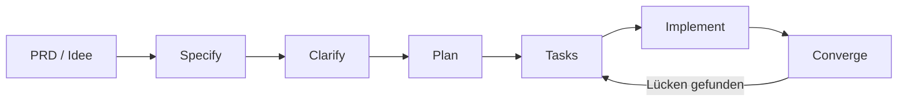

# Spec-Driven Development
## Mit AI-Agent-Squads vom PRD zum autonomen Code

**Sessionvorschlag · EKON 30 · Düsseldorf, November 2026 · 60 Min. · Harald Binkle & Thomas Tomow**

<!--
Einstieg: Ein Agent kann in Minuten viele Dateien ändern. Die entscheidende Frage ist nicht, wie schnell er Code schreibt, sondern ob das Team vorher klar genug beschrieben hat, was richtig bedeutet.
-->

---
title: Speaker
layout: intro
src: /special-slides/ekon30-speakers.md

---

---
layout: cover
coverImage: /bmad-project-failure-aircraft.png
hideInToc: true
---

# Der Agent hat geliefert.
## Aber hat er das Richtige gebaut?

<v-clicks>

- Der PRD sagt: „Benutzer können Termine verwalten.“
- Der Agent liefert Code.
- Niemand weiß, ob Zeitzonen, Konflikte und Berechtigungen gemeint waren.

</v-clicks>

<!--
Teaser mit kurzen Pausen. Die Lücke zwischen Absicht und prüfbarem Verhalten ist der eigentliche Engpass.
-->

---
title: Sessionprofil
layout: image-right
background: /bmad-context-satellite.png
hideInToc: true
---

# Vom Wunsch zur überprüfbaren Lieferung

<v-clicks>

- **Format:** Impulsvortrag mit drei kurzen Live-Demos
- **Zielgruppe:** Entwickler:innen, Tech Leads und Architekt:innen
- **Vorkenntnisse:** Grundverständnis von Anforderungen und KI-Coding-Assistenten
- **Ergebnis:** ein nachvollziehbarer Weg von der Produktidee zu getesteten Änderungen

</v-clicks>

<!--
In einem Satz: Wir zeigen keinen Autopiloten ohne Kontrolle, sondern einen überprüfbaren Entwicklungsprozess, in dem GitHub Copilot die Arbeit beschleunigt.
-->

---
title: Agenda
layout: image-right
background: /compass-right.png
hideInToc: true
---

# In 60 Minuten

<v-clicks>

- 00–12′ Warum Prompt-zu-Code allein nicht skaliert
- 12–25′ PRD, Spezifikation und Qualitätskriterien
- 25–42′ Agent-Squad und Arbeitsfluss mit GitHub Copilot
- 42–53′ Drei Demos: Specify → Plan → Implementieren
- 53–60′ Qualität, Grenzen und Fragen

</v-clicks>

<!--
Die Zeiten ergeben 60 Minuten inklusive Fragen. Falls die Diskussion länger wird, Demo 3 auf den vorbereiteten Ergebnis-PR verkürzen.
-->

---
layout: chapter-dark
background: /bmad-dev-ideas-to-tests.png
---

# 01 · Erst Klarheit, dann Code

<!--
Übergang: Mehr Agenten und bessere Modelle lösen keine unklaren Anforderungen.
-->

---
title: Der Engpass ist nicht das Tippen
layout: image-right
background: /bmad-kosten-anforderungsfehler.png
---

# Mehr Output ist nicht automatisch mehr Fortschritt

<v-clicks>

- Vage Ziele erzeugen plausible, aber unterschiedliche Interpretationen.
- Fehlender Kontext wird mit Annahmen aufgefüllt.
- Ohne Akzeptanzkriterien bleibt „fertig“ subjektiv.
- Fehler früh in der Spezifikation zu finden ist günstiger als nach vielen Änderungen.

</v-clicks>

<!--
Das Publikum fragen: Wo wird bei euch „fertig“ heute festgelegt — im Ticket, im PR oder erst im Review?
-->

---
title: PRD ist Orientierung, Spezifikation ist Vertrag
layout: image-left
background: /bmad-context-hierarchy.png
---

# Vom „Warum“ zum testbaren „Was“

<v-clicks>

- **PRD:** Nutzerproblem, Ziel, Nutzen und Erfolgssignale
- **Spec:** Verhalten, Randfälle, Akzeptanzkriterien und Nicht-Ziele
- **Plan:** Architektur, Datenfluss und technische Entscheidungen
- **Tasks:** kleine, abhängige und überprüfbare Arbeitspakete

</v-clicks>

<!--
Die Dokumente sind kein Selbstzweck. Jedes Artefakt reduziert eine andere Unsicherheit und wird zur Eingabe für den nächsten Schritt.
-->

---
title: Eine gute Spezifikation macht Lücken sichtbar
layout: default
---

# Beispiel: „Termin absagen“

<v-click>

**Zu vage:** „Nutzer können einen Termin absagen.“

</v-click>

<v-clicks>

- Wer darf absagen — Teilnehmer:in, Organisator:in oder beide?
- Was passiert mit Benachrichtigungen und Warteliste?
- Welche Frist gilt? Welche Zeitzone?
- Wie wird Erfolg oder ein Konflikt überprüft?

</v-clicks>

<!--
Die Fragen sind hier wichtiger als eine vorschnelle Lösung. Gute Spec-Arbeit macht Annahmen explizit und lädt das Team zur Entscheidung ein.
-->

---
title: Der Entwicklungsfluss
layout: image-right
background: /bmad-agent-fleet.png
---

# Artefakte statt Mega-Prompt

<!--
Der aktuelle Spec Kit Kernprozess führt Specify, Plan, Tasks, Implement und Converge. Clarify ist ein sinnvoller Klärungsschritt, wenn Unsicherheit bleibt. Quelle: https://github.github.com/spec-kit/
-->

---
title: Was „Agent-Squad“ hier bedeutet
layout: image-left
background: /bmad-agents-specialized-experts.png
---

# Rollen trennen, Ergebnisse verbinden

<v-clicks>

- **Product/Requirements:** macht Ziele und offene Fragen sichtbar
- **Architect:** schlägt Plan und Constraints vor
- **Implementer:** arbeitet auf klar abgegrenzten Tasks
- **Tester/Reviewer:** prüft Verhalten gegen Spec und Tests
- **Mensch:** entscheidet, priorisiert und verantwortet den Merge

</v-clicks>

<!--
Squad bezeichnet hier die Arbeitsteilung, nicht die Behauptung, dass jede Copilot-Oberfläche beliebig viele Agenten parallel ausführt. Copilot-Funktionen und Agenten-Unterstützung unterscheiden sich je nach Produktoberfläche.
-->

---
title: Demo 1 · Aus Idee wird Spec
layout: image-right
background: /bmad-context-hierarchy.png
---

# Demo 1 · Fragen vor Formulierungen

<v-clicks>

- PRD-Satz in GitHub Copilot bereitstellen
- Nutzer, Randfälle und Nicht-Ziele klären lassen
- Akzeptanzkriterien als beobachtbares Verhalten formulieren

</v-clicks>

<!--
Live-Demo, ca. 3 Minuten: ein kleines Feature wählen, etwa „Wartelistenplatz freigeben“. Copilot zunächst nur Fragen stellen lassen. Unklare Produktentscheidungen markieren und mit dem Publikum eine davon entscheiden. Danach Spec-Artefakt prüfen, nicht ungeprüft übernehmen.
-->

---
title: Demo 2 · Plan und Tasks
layout: image-left
background: /bmad-navigation-compass-ai.png
---

# Demo 2 · Planung vor Delegation

<v-clicks>

- Spec gegen bestehende Architektur und Repository-Konventionen lesen
- technische Risiken und Abhängigkeiten benennen
- Tasks so schneiden, dass jeder Task prüfbar bleibt

</v-clicks>

<!--
Live-Demo, ca. 3 Minuten: in Copilot Agent Mode zuerst Plan anfordern. Den Plan mit Spec und vorhandenen Tests vergleichen. Eine Task-Abhängigkeit oder einen nicht entschiedenen API-Vertrag sichtbar machen.
-->

---
title: Demo 3 · Implementieren und konvergieren
layout: image-right
background: /bmad-governance-control-center.png
---

# Demo 3 · Code ist ein Zwischenstand

<v-clicks>

- kleine Tasks mit GitHub Copilot umsetzen
- Tests aus Akzeptanzkriterien ableiten und ausführen
- Diff und Testergebnis gegen Spec prüfen
- bei Abweichung Spec/Task korrigieren — nicht stillschweigend die Absicht ändern

</v-clicks>

<!--
Live-Demo, ca. 5 Minuten: vorbereiteten Branch oder kleines Repository nutzen. Tests, Diff und einen gezielt eingebauten Randfall zeigen. Fallback: vorbereiteter PR und Testlauf, falls Netzwerk oder Modell hakt.
-->

---
title: Qualitätsgates halten Autonomie überprüfbar
layout: image-right
background: /bmad-governance-control-center.png
---

# Autonom arbeiten, nicht autonom freigeben

<v-clicks>

- Spec-Check: vollständig, testbar, widerspruchsfrei?
- Task-Check: klein genug und zur Spec rückverfolgbar?
- Code-Check: Tests, Lint, Security und Diff geprüft?
- Merge-Check: verantwortliche Person entscheidet

</v-clicks>

<!--
Betonen: „autonomer Code“ heißt hier agentisch erzeugte Änderungen innerhalb expliziter Grenzen. Kein Versprechen unbeaufsichtigter Produktionsfreigabe.
-->

---
title: Takeaways
layout: statement
---

# Gute Spezifikationen sind ausführbarer Teamkontext.

<v-clicks>

- zuerst Absicht und Grenzen klären
- Artefakte schrittweise verfeinern
- Copilot auf kleine, überprüfbare Aufgaben ansetzen
- Qualität und Verantwortung beim Team lassen

</v-clicks>

<!--
Die zentrale Mitnahme: Nicht „mehr Prompt“, sondern weniger Mehrdeutigkeit an den Übergaben.
-->

---
title: Quellen
layout: default
hideInToc: true
---

# Quellen & Einordnung

<v-clicks>

- [EKON 30 · KI Praxis und Tools für Delphi](https://entwickler-konferenz.de/ki-praxis-und-tools-fuer-delphi/)
- [GitHub Spec Kit: Prozess und Agentic SDD](https://github.github.com/spec-kit/)
- [Copilot: Customization Cheat Sheet](https://docs.github.com/en/copilot/reference/customization-cheat-sheet)
- Bestehende Repository-Inhalte: BMad, Context Engineering und GitHub Copilot

</v-clicks>

<!--
Die EKON-Seite positioniert den Track praxisnah: vom Copilot-Alltag bis zu Agent-Teams, die Spezifikationen in produktiven Code überführen.
-->

---
src: /special-slides/questions.md
---

---
src: /special-slides/thank-you.md
---
