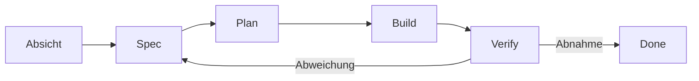

# Spec-Driven Development

## BMad: Vom PRD zu überprüfbarem Code

**EKON 30 · Düsseldorf, November 2026 · Harald Binkle & Thomas Tomow**

<!--
Einstieg: Ein Agent kann in Minuten viele Dateien ändern. Die entscheidende Frage ist nicht, wie schnell er Code schreibt, sondern ob das Team vorher klar genug beschrieben hat, was richtig bedeutet.
-->

---
title: Speaker
layout: intro
src: /special-slides/ekon30-speakers.md

---

---
layout: cover
coverImage: bmad-project-failure-aircraft.png
isDark: true
hideInToc: true
---

# Der Agent hat geliefert.

## Aber hat er das Richtige gebaut?

<v-clicks>

- Der PRD sagt: „Benutzer können Termine verwalten.“
- Der Agent liefert Code.
- Niemand weiß, ob Zeitzonen, Konflikte und Berechtigungen gemeint waren.

</v-clicks>

<!--
Teaser mit kurzen Pausen. Die Lücke zwischen Absicht und prüfbarem Verhalten ist der eigentliche Engpass. Danach wechseln wir für den roten Faden zum konkreten Session-Katalog: Sessions pro Track zählen.
-->

---
title: Sessionprofil
layout: image-right
background: bmad-context-satellite.png
hideInToc: true
---

# Vom Wunsch zur überprüfbaren Lieferung

<v-clicks>

- **Format:** Impulsvortrag mit einem durchgehenden Live-Demo-Faden
- **Zielgruppe:** Entwickler:innen, Tech Leads und Architekt:innen
- **Vorkenntnisse:** Grundverständnis von Anforderungen und KI-Coding-Assistenten
- **Ergebnis:** ein nachvollziehbarer Weg von der Produktidee zu getesteten Änderungen

</v-clicks>

<!--
In einem Satz: Wir zeigen keinen Autopiloten ohne Kontrolle, sondern einen überprüfbaren Entwicklungsprozess, in dem GitHub Copilot die Arbeit beschleunigt.
-->

---
title: Agenda
layout: image-right
background: compass-right.png
hideInToc: true
---

# Vom PRD zur prüfbaren Lieferung

<v-clicks>

- Warum Prompt-zu-Code allein nicht skaliert
- PRD, Ticket-Spec und Qualitätskriterien
- BMad Method: Klarheit, Planung und Rollenteilung
- Ein Demo-Faden mit Demo Time: Clarify → Plan → Build & verify
- Learn & adjust: Qualität, Grenzen und Fragen

</v-clicks>

<!--
Die Phasen desselben Demo-Fadens enthalten Prompt-Warten, Wechsel, Erläuterungen, Tests und Fallback. Vorbereitung und Bedienung: https://github.com/harrybin/presentations/blob/main/demo-projects/ekon30-talk-demo/README.md (lokal `demo-projects/ekon30-talk-demo/README.md`); in VS Code die Erweiterung **Demo Time** öffnen und den Akt `EKON 30 · Spec-Driven Development` (`.run/baseline/.demo/sdd-talk.json`) auswählen. Bei Zeitdruck Live-Pfad abkürzen und spätestens zum Ende der aktuellen Phase weitergehen.
Quelle zum Konferenzkontext: https://entwickler-konferenz.de/ki-praxis-und-tools-fuer-delphi/
-->

---
title: Spec-Driven Development
layout: default
---

# Eine Spec ist ein überprüfbarer Vertrag



<v-clicks>

- Jeder Schritt hinterlässt ein prüfbares Artefakt.
- Die Spec verbindet Produktabsicht mit Tests und Änderungen.
- Feedback darf die Spec ändern — aber nicht unbemerkt den Vertrag.

</v-clicks>

<!--
Das ist ein Arbeitsmodell, keine Behauptung, dass jede Änderung alle Stationen durchlaufen muss. BMad nutzt je nach Umfang und Risiko passende Pfade.
Quelle: https://docs.bmad-method.org/start/how-bmad-works/
-->

---
layout: chapter
background: bmad-dev-ideas-to-tests.png
isDark: true
---

# 01 · Erst Klarheit, dann Code

<!--
Übergang: Mehr Agenten und bessere Modelle lösen keine unklaren Anforderungen.
-->

---
title: Der Engpass ist nicht das Tippen
layout: image-right
background: bmad-kosten-anforderungsfehler.png
---

# Mehr Output ist nicht automatisch mehr Fortschritt

<v-clicks>

- Vage Ziele erzeugen plausible, aber unterschiedliche Interpretationen.
- Fehlender Kontext wird mit Annahmen aufgefüllt.
- Ohne Akzeptanzkriterien bleibt „fertig“ subjektiv.
- Fehler früh in der Spezifikation zu finden ist günstiger als nach vielen Änderungen.

</v-clicks>

<!--
Das Publikum fragen: Wo wird bei euch „fertig“ heute festgelegt — im Ticket, im PR oder erst im Review?
-->

---
title: BMad macht das Ticket zur Spezifikation
layout: image-left
background: bmad-context-hierarchy.png
---

# Das Ticket ist die belastbare Spec

<v-clicks>

- **PRD oder Brief:** Quelle, wenn mehrere Beteiligte sich abstimmen müssen
- **Sofia (Product Owner):** überführt Quellen in Tickets mit stabilen Requirement-IDs
- **Ticket = Spec:** Requirements, Constraints, Done when und Boundaries
- **Build-Plan:** Vorgehen für eine Story; Umfang passt sich dem Risiko an

</v-clicks>

<!--
Ein PRD ist optional: BMad ergänzt nur die Planung, die Größe und Risiko der Arbeit rechtfertigen. Für eine Story reicht oft das Ticket; der Build-Plan hält Vorgehen und Status fest.
-->

---
title: Eine gute Spezifikation macht Lücken sichtbar
layout: default
---

# Beispiel: Sessions pro Track

<v-click>

**Zu vage:** „Zähle Sessions je Track.“

</v-click>

<v-clicks>

- Sind `KI` und `ki` derselbe Track?
- Welche Reihenfolge haben die Ergebnisse?
- Was passiert bei leerem Track oder leerer Liste?
- Darf die Eingabe verändert werden?

</v-clicks>

<!--
Dieselbe Story zieht sich durch den gesamten Demo-Faden: Sessions je Track zählen. Die Spec entscheidet über exakten Vergleich, Reihenfolge des ersten Auftretens, leeren Track als eigenen Schlüssel und unveränderte Eingaben. Gute Spec-Arbeit macht Annahmen explizit und lädt das Team zur Entscheidung ein.
-->

---
title: Ein Beispiel wird erst mit Daten konkret
layout: image-right
background: bmad-collaboration-requirements.png
---

# Beispiel: Eingabe und erwartetes Ergebnis

```text
Sessions: KI · Delphi · KI · ki · ""
```

<v-click>

```text
Ergebnis: KI:2 · Delphi:1 · ki:1 · "":1
```

</v-click>

<v-clicks>

- `KI` und `ki` bleiben getrennte Schlüssel.
- Die Reihenfolge folgt dem ersten Auftreten.
- Der leere Name ist ein Wert, kein fehlender Datensatz.

</v-clicks>

<!--
Diese Werte entsprechen dem Fixture in demo-projects/ekon30-talk-demo/fixtures/common/CatalogTests.lpr und der vorbereiteten Ticket-Spec unter demo-projects/ekon30-talk-demo/spec.md.
-->

---
title: Requirements in Ebenen
layout: default
---

# Vom Ziel zur umsetzbaren Story

<div class="grid grid-cols-3 gap-5 mt-8">
  <div v-click class="ekon30-flow__step">
    <strong>GOAL-1</strong>
    <p>Sessions pro Track zählen</p>
  </div>
  <div v-click class="ekon30-flow__step">
    <strong>R1–R4</strong>
    <p>Exakter Vergleich, Reihenfolge, leere Werte, unveränderte Eingabe</p>
  </div>
  <div v-click class="ekon30-flow__step">
    <strong>RULE-1</strong>
    <p>Keine GUI, API, Datenbank oder Parallelisierung</p>
  </div>
</div>

<v-click>

**Warum IDs?** Eine Diskussion kann auf dieselbe Anforderung zeigen — vom PRD bis zum Test.

</v-click>

<!--
Im Beispiel stammen GOAL-1 und RULE-1 aus dem Brief, R1 bis R4 aus der Story-Spec. Die BMad-Ticket-Struktur verknüpft Requirement-IDs über Initiative und Story.
Quelle: https://docs.bmad-method.org/reference/ticket-tree/
-->

---
title: Akzeptanzkriterien sind beobachtbar
layout: default
---

# „Funktioniert“ wird zu einem prüfbaren Verhalten

| Eingabe          | Erwartung                     | Abgedeckte Regel      |
| ---------------- | ----------------------------- | --------------------- |
| `KI, Delphi, KI` | `KI:2, Delphi:1`              | Exakte Zählung        |
| `KI, ki`         | Zwei Ergebnisse               | Groß-/Kleinschreibung |
| `Delphi, KI`     | Diese Reihenfolge             | Erstes Auftreten      |
| `KI, ""`         | Leerer Track bleibt enthalten | Leerer Schlüssel      |
| `nil`            | Keine Ergebnisse              | Leere Eingabe         |

<v-click>

**Gute Kriterien beschreiben Resultate, keine Implementierungsdetails.**

</v-click>

<!--
Für die Diskussion: Welche Zeile wäre in eurem Code-Review sonst nur implizite Annahme? Nicht die Tabelle mit vollständiger Verifikation verwechseln; sie zeigt ausgewählte Vertragsfälle.
-->

---
title: Der Entwicklungsfluss
layout: default
---

# Vier Schritte, ein gemeinsamer Ticket-Faden

<div class="ekon30-flow ekon30-flow--four">
  <div v-click class="ekon30-flow__step">
    <strong>Clarify</strong>
    <p>Absicht, Grenzen und offene Fragen</p>
  </div>
  <div v-click class="ekon30-flow__step">
    <strong>Plan</strong>
    <p>Ticket-Spec und passende Arbeitseinheiten</p>
  </div>
  <div v-click class="ekon30-flow__step">
    <strong>Build &amp; verify</strong>
    <p>Eine Story bauen, prüfen und reviewen</p>
  </div>
  <div v-click class="ekon30-flow__step">
    <strong>Learn &amp; adjust</strong>
    <p>Am Epic-Ende Bilanz ziehen, Plan anpassen</p>
  </div>
</div>

<!--
Die vier Stufen sind keine starre Pipeline: Kleine Änderungen starten direkt bei Build & verify; PRD, UX und Architektur kommen nur bei Bedarf hinzu. Learn & adjust schließt ein Epic ab, nicht jede einzelne Story.
Quelle: https://docs.bmad-method.org/start/how-bmad-works/
-->

---
title: Der Vertrag passt zur Datenstruktur
layout: default
---

# Delphi-Typen machen die Grenze sichtbar

```pascal
type
  TSession = record
    Track: string;
  end;
  TSessions = array of TSession;
  TTrackCount = record
    Track: string;
    Count: Integer;
  end;

function CountSessionsByTrack(
  const Sessions: TSessions
): TTrackCounts;
```

<v-clicks>

- `const` signalisiert: die Eingabe wird nicht verändert.
- Ergebnis und Eingabe sind getrennte Datentypen.
- Der Vertrag sagt noch nicht, wie gezählt wird.

</v-clicks>

<!--
Auszug aus demo-projects/ekon30-talk-demo/fixtures/common/SessionData.pas und SessionCatalog.pas. `const` ist hier die Schnittstellenabsicht; der Test prüft zusätzlich, dass die übergebenen Werte unverändert bleiben.
-->

---
title: Ein Vergleich, eine fachliche Entscheidung
layout: default
---

# Der kleinste Code-Edit ändert die Bedeutung

````md magic-move
```pascal
if SameText(Result[J].Track, Sessions[I].Track) then
  Found := J;
```

```pascal
if Result[J].Track = Sessions[I].Track then
  Found := J;
```
````

<v-clicks>

- `SameText` faltet Schreibweisen zusammen.
- `=` bewahrt den vereinbarten exakten Vergleich.
- Ein Test muss den Unterschied `KI` / `ki` sichtbar machen.

</v-clicks>

<!--
Die erste Variante ist der absichtliche Fehler in fixtures/baseline/SessionCatalog.pas. Die zweite stammt aus fixtures/solution/SessionCatalog.pas. Magic Move entwickelt denselben Codeblock Schritt für Schritt; beide Zustände sind vorbereitete Fixtures, kein live erzeugtes Agent-Ergebnis.
-->

---
title: Algorithmus und bewusste Grenzen
layout: image-left
background: bmad-risk-lock.png
---

# Korrektheit zuerst — Optimierung nach Bedarf

<div class="grid grid-cols-2 gap-10 mt-6">

<div>

## Aktuelle Lösung

- Für jeden Eintrag Ergebnis durchsuchen
- Beim ersten Treffer Zähler erhöhen
- Sonst Ergebnis in Reihenfolge erweitern

</div>

<div>

## Konsequenz

- Laufzeit: **O(n²)** im Worst Case
- Zusätzlicher Speicher: **O(k)** für `k` Tracks
- Für den Demo-Scope: einfach, deterministisch, testbar

</div>

</div>

<!--
Keine Performancebehauptung: Das Fixture enthält keine Lastanforderung und kein Benchmark. Bei großen Katalogen wären Hash-Lookup und explizite Ordnung eine eigene, durch Messung begründete Änderung — nicht stillschweigend Teil dieses Tickets.
-->

---
title: Was „Agent-Squad“ hier bedeutet
layout: image-left
background: bmad-agents-specialized-experts.png
---

# Rollen trennen, Ergebnisse verbinden

<v-clicks>

- **Mary (Analyst):** klärt eine vage Idee; **John (PM):** schreibt bei Bedarf ein PRD
- **Sofia (PO):** pflegt Anforderungen und schneidet Tickets
- **Sally (UX) / Winston (Architekt):** ergänzen Spezialwissen, wenn es gebraucht wird
- **Amelia (`bmad-build`):** plant, implementiert und reviewt eine Story
- **Mensch:** entscheidet offene Fragen, prüft das Ergebnis und markiert es „done“

</v-clicks>

<!--
Die Rollen sind die BMad-Arbeitsteilung, keine Behauptung paralleler Ausführung. In der Demo arbeiten Sofia und Amelia nacheinander; die Person steuert Entscheidungen und Abnahme.
Quelle: https://docs.bmad-method.org/start/how-bmad-works/
-->

---
title: Kontext nicht vermischen
layout: image-right
background: bmad-project-context-agent-brain.png
---

# Jede Quelle hat eine andere Aufgabe

<v-clicks>

- **Brief:** fachliches Ziel und offene Fragen
- **Ticket:** entschiedene Regeln, Constraints und Done when
- **Repository:** vorhandene Typen, Tests und Stil
- **Prompt:** konkreter Auftrag für diesen Arbeitsschritt
- **Build-Plan:** Reihenfolge, betroffene Dateien und Nachweise

</v-clicks>

<v-click>

**Konflikt?** Nicht raten: Quelle und Entscheidung klären.

</v-click>

<!--
In der Demo ist context/copilot-instructions.md ein absichtlich explizit angefügtes Fixture, keine automatisch geladene Projektregel. Copilot-Anpassung hängt von der aktiven Oberfläche und dem jeweiligen Kontext ab.
Quelle: https://docs.github.com/en/copilot/reference/customization-cheat-sheet
-->

---
title: Demo-Faden · Von der Idee zum Ticket
layout: image-right
background: bmad-context-hierarchy.png
---

# Ein roter Faden · Die Story wird zur Spec

<v-clicks>

- **Start · 3 Min.** · Sofia (`bmad-agent-po`) liest `prd.md`
- Eine Story für genau einen Build-Scope schneiden
- Groß-/Kleinschreibung und Randfälle explizit festhalten
- Fallback: vorbereitete Ticket-Spec in `spec.md`

</v-clicks>

<!--
Konkreter Ablauf: erster Schritt im durchgehenden Demo-Faden, siehe `demo-projects/ekon30-talk-demo/README.md`. BMad vorab ausschließlich in `.run/baseline` installieren. Nach 45 Sekunden ohne brauchbares Ticket die vorbereitete `spec.md` zeigen; sie ist ein Offline-Fallback und kein von Sofia erzeugtes Artefakt.
-->

---
title: Ein Prompt macht den Auftrag begrenzt
layout: default
---

# Sofia: genau ein Ticket — keine Implementierung

```text
/bmad-agent-po Schreibe aus #file:prd.md ein Standalone-Ticket
für genau eine Story und eine Build-Sitzung unter
_bmad-output/backlog/ticket-sessions-je-track.md.

Stelle Rückfragen zu offenen fachlichen Entscheidungen,
statt Annahmen als Fakten einzutragen. Nicht implementieren.
```

<v-clicks>

- **Rolle** und **Quelle** sind explizit.
- Zielpfad und Umfang sind begrenzt.
- Rückfragen sind erwünschtes Verhalten, kein Fehler.

</v-clicks>

<!--
Wörtlicher Auszug aus demo-projects/ekon30-talk-demo/README.md. Die konkrete Sofia-Ausgabe live prüfen; das Offline-Ticket ist nicht als live generiert ausgeben.
Quelle zum Planen und Schneiden von Initiativen: https://docs.bmad-method.org/plan/write-and-slice-the-initiative/
-->

---
title: Ticket-Spec · Der Vertrag bleibt sichtbar
layout: image-left
background: bmad-context-hierarchy.png
---

# Entscheidungen werden prüfbare Anforderungen

<div class="grid grid-cols-2 gap-10 mt-6">

<div>

**Fachlicher Vertrag**

<v-clicks>

- `KI` und `ki` sind verschiedene Tracks
- Ergebnisse folgen dem ersten Auftreten
- Leere Namen zählen; leere Eingabe ergibt nichts

</v-clicks>

</div>

<div>

**Arbeitsgrenzen**

<v-clicks>

- Eingabe und Einträge bleiben unverändert
- nur `SessionCatalog.pas` ändern
- vorhandene Tests liefern den Nachweis

</v-clicks>

</div>

</div>

<!--
Das sind die konkreten Anforderungen und Grenzen der vorbereiteten Ticket-Spec. Im Live-Pfad prüfen wir Sofias tatsächliches Ticket; bei Timeout klar als Offline-Fallback kennzeichnen.
-->

---
title: Done when schließt Interpretationslücken
layout: default
---

# Die Definition of Done ist konkret

```text
KI, Delphi, KI, ki, ""
→ KI:2, Delphi:1, ki:1, "":1

nil → leeres Ergebnis
Eingabeliste → unverändert
```

<v-clicks>

- Ergebniswerte und Reihenfolge sind beobachtbar.
- Eingabeintegrität wird separat geprüft.
- „Tests bestanden“ bedeutet nicht automatisch „fachlich akzeptiert“.

</v-clicks>

<!--
Auszug aus demo-projects/ekon30-talk-demo/spec.md. Die vorbereitete Referenz hat sieben Checks; sie sind Belege für diese Anforderungen, aber keine vollständige formale Verifikation.
-->

---
title: Demo-Faden · Ticket wird zum Build-Plan
layout: image-left
background: bmad-navigation-compass-ai.png
---

# Derselbe Ticket-Faden · Den Build planen

<v-clicks>

- **Weiter · 3 Min.** · frischer Build-Chat mit `bmad-build`
- Dasselbe Ticket und der Pascal-Code bleiben der Kontext
- Vorgehen und offene Fragen prüfen, vor Codeänderungen pausieren

</v-clicks>

<!--
Der Chat wechselt wegen der sauberen Build-Sitzung, nicht die Story: BMad baut auf Sofias Ticket auf. Wenn die Antwort nach 45 Sekunden ausbleibt oder die geplante Änderung außerhalb des Scopes liegt, den Offline-Plan in `plan.md` zeigen; er ist keine BMAD-generierte Build-Plan-Datei.
-->

---
title: Ein kleiner Plan ist trotzdem überprüfbar
layout: default
---

# Vor dem Edit die Arbeit sichtbar machen

```text
1. SessionData.pas, Ticket und Tests lesen
2. Nur SessionCatalog.pas ändern
3. Bestehende Pascal-Checks ausführen
4. Diff gegen Anforderungen prüfen
```

<v-clicks>

- Erst Repository und Tests untersuchen.
- Plan auf den Story-Scope begrenzen.
- Vor Änderungen für die Freigabe pausieren.

</v-clicks>

<!--
Der Text ist eine Kurzfassung der vorbereiteten Offline-Planreferenz demo-projects/ekon30-talk-demo/plan.md, kein live erzeugter Build-Plan. Die BMad-Dokumentation beschreibt Build & Verify: https://docs.bmad-method.org/build/build-and-verify/
-->

---
title: Der Build-Plan ist ein Entscheidungspunkt
layout: default
---

# Vor dem ersten Edit ist der Scope sichtbar

<div class="ekon30-flow ekon30-flow--four">
  <div v-click class="ekon30-flow__step">
    <strong>Ticket lesen</strong>
    <p>Requirements und Grenzen übernehmen</p>
  </div>
  <div v-click class="ekon30-flow__step">
    <strong>Änderung planen</strong>
    <p>Nur die betroffenen Dateien und Schritte</p>
  </div>
  <div v-click class="ekon30-flow__step">
    <strong>Nachweis festlegen</strong>
    <p>Vorhandene Checks ausführen</p>
  </div>
  <div v-click class="ekon30-flow__step">
    <strong>Freigabe abwarten</strong>
    <p>Der Mensch entscheidet vor dem Build</p>
  </div>
</div>

<!--
Der Plan verbindet Ticket und Umsetzung. Die Pause vor Codeänderungen ist die sichtbare menschliche Kontrollstelle, auch wenn BMad für eine kleine Story einen verkürzten Light-Path wählt.
-->

---
title: Demo-Faden · Build und Verifikation
layout: image-right
background: bmad-governance-control-center.png
---

# Derselbe Ticket-Faden · Bauen, prüfen, abnehmen

<v-clicks>

- **Abschluss · 5 Min.** · den freigegebenen Plan im selben `bmad-build`-Chat umsetzen
- Nur `SessionCatalog.pas` ändern, Tests ausführen und reviewen
- Ergebnis und Status `built` prüfen; „done“ bleibt Menschensache
- bei Timeout: vorbereitete Referenzlösung und Test zeigen

</v-clicks>

<!--
Vorab im Demo-Verzeichnis `node demo.mjs prepare` und `node demo.mjs test baseline` ausführen: Der absichtliche Fehler muss scheitern. Im Vortrag in der Erweiterung **Demo Time** den Akt `EKON 30 · Spec-Driven Development` (`.run/baseline/.demo/sdd-talk.json`) nur im isolierten Workspace starten. Nach 60 Sekunden oder Scope-Verstoß Agent abbrechen; die Fallback-Szene zeigt `node demo.mjs test solution` und `node demo.mjs diff`. BMad Build kann lokal committen; im Demo-Workspace darf nichts gepusht werden. `solution` ist eine vorbereitete Referenz, kein live erzeugtes Agent-Ergebnis.
-->

---
title: Der Test trifft genau die Mehrdeutigkeit
layout: default
---

# Ein gezielter Check macht den Fehler reproduzierbar

````md magic-move
```pascal
SetLength(Sessions, 1);
Sessions[0].Track := 'KI';

Counts := CountSessionsByTrack(Sessions);
Check(Length(Counts) = 1, 'Ein Track wird gezählt');
```

```pascal
SetLength(Sessions, 2);
Sessions[0].Track := 'KI';
Sessions[1].Track := 'ki';

Counts := CountSessionsByTrack(Sessions);
Check(Length(Counts) = 2,
  'KI und ki sind getrennte Tracks');
```
````

<v-clicks>

- Baseline: der case-insensitive Vergleich verletzt R1.
- Referenz: beide Schreibweisen bleiben getrennt.
- Der Test benennt Fachverhalten statt interne Schleifen.

</v-clicks>

<!--
Auszug aus fixtures/common/CatalogTests.lpr. `node demo.mjs test baseline` soll fehlschlagen; `node demo.mjs test solution` führt alle sieben vorbereiteten Checks aus. Vortragsdemo: keine Erfolgsmeldung behaupten, ohne den konkreten Lauf zu zeigen.
-->

---
title: Built ist noch nicht Done
layout: image-left
background: bmad-human-ai-copilot.png
---

# Der Agent liefert — das Team nimmt ab

<div class="grid grid-cols-2 gap-10 mt-7">

<div>

## Built

- freigegebener Scope umgesetzt
- vorhandene Checks gelaufen
- tatsächlicher Diff nachvollziehbar

</div>

<div>

## Done

- Ergebnis gegen Ticket geprüft
- Grenzen und Annahmen bestätigt
- verantwortliche Person gibt frei

</div>

</div>

<!--
Die Demo endet mit einem gebauten, geprüften Ergebnis im lokalen Workspace. BMADs Status built ist keine Produktionsfreigabe; die menschliche Abnahme bleibt Teil des roten Fadens.
-->

---
title: Derselbe Ticket-Scope · Der Test macht den Unterschied sichtbar
layout: default
---

# Die fachliche Regel wird zum überprüfbaren Ergebnis

<div class="ekon30-flow ekon30-flow--four">
  <div v-click class="ekon30-flow__step">
    <strong>Ticket</strong>
    <p>`KI` und `ki` sind getrennte Tracks</p>
  </div>
  <div v-click class="ekon30-flow__step">
    <strong>Baseline</strong>
    <p>Der gezielte Groß-/Kleinschreibungs-Check schlägt fehl</p>
  </div>
  <div v-click class="ekon30-flow__step">
    <strong>Referenzlösung</strong>
    <p>7 vorbereitete Checks bestanden</p>
  </div>
  <div v-click class="ekon30-flow__step">
    <strong>Abnahme</strong>
    <p>Diff auf `SessionCatalog.pas` prüfen; erst dann „done“</p>
  </div>
</div>

<!--
Die gezeigten Testergebnisse stammen aus der vorbereiteten Referenz mit isoliertem FPC 3.2.2, nicht aus einer live von BMAD erzeugten Änderung. Im Live-Pfad tatsächlichen Agent-Diff und Testlauf prüfen; die Referenz ist der zeitgebundene Fallback.
-->

---
title: Qualitätsgates halten Autonomie überprüfbar
layout: image-right
background: bmad-governance-control-center.png
---

# Autonom arbeiten, nicht autonom freigeben

<v-clicks>

- Ticket-Check: Requirements, Quellen, Constraints und Grenzen stimmig?
- Build-Check: Umfang und Vorgehen passen zu einer Story?
- Ergebnis-Check: Tests, Review und Diff geprüft?
- Abnahme: verantwortliche Person markiert die Story „done“

</v-clicks>

<!--
Betonen: „autonomer Code“ heißt hier agentisch erzeugte Änderungen innerhalb expliziter Grenzen. Kein Versprechen unbeaufsichtigter Produktionsfreigabe.
-->

---
title: Takeaways
layout: statement
---

# Gute Spezifikationen sind ausführbarer Teamkontext.

<v-clicks>

- BMad wählt die kleinste passende Route
- Das Ticket hält Anforderungen und Grenzen stabil
- `bmad-build` baut und prüft eine Story pro Sitzung
- Qualität und Verantwortung beim Team lassen

</v-clicks>

<!--
Die zentrale Mitnahme: Nicht „mehr Prompt“, sondern weniger Mehrdeutigkeit an den Übergaben.
-->

---
src: /special-slides/questions.md
---

---
src: /special-slides/thank-you.md
---
