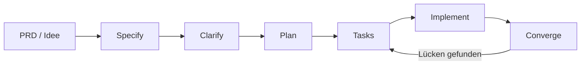

# Spec-Driven Development
## Mit AI-Agent-Squads vom PRD zum autonomen Code

**Sessionvorschlag · EKON 30 · Düsseldorf, November 2026 · 60 Min. · Harald Binkle & Thomas Tomow**

<!--
Einstieg: Ein Agent kann in Minuten viele Dateien ändern. Die entscheidende Frage ist nicht, wie schnell er Code schreibt, sondern ob das Team vorher klar genug beschrieben hat, was richtig bedeutet.
-->

---
title: Speaker
layout: intro
src: /special-slides/ekon30-speakers.md

---

---
layout: cover-dark
coverImage: /bmad-project-failure-aircraft.png
hideInToc: true
---

# Der Agent hat geliefert.
## Aber hat er das Richtige gebaut?

<v-clicks>

- Der PRD sagt: „Benutzer können Termine verwalten.“
- Der Agent liefert Code.
- Niemand weiß, ob Zeitzonen, Konflikte und Berechtigungen gemeint waren.

</v-clicks>

<!--
Teaser mit kurzen Pausen. Die Lücke zwischen Absicht und prüfbarem Verhalten ist der eigentliche Engpass. Danach wechseln wir für den roten Faden zum konkreten Session-Katalog: Sessions pro Track zählen.
-->

---
title: Sessionprofil
layout: image-right
background: /bmad-context-satellite.png
hideInToc: true
---

# Vom Wunsch zur überprüfbaren Lieferung

<v-clicks>

- **Format:** Impulsvortrag mit drei kurzen Live-Demos
- **Zielgruppe:** Entwickler:innen, Tech Leads und Architekt:innen
- **Vorkenntnisse:** Grundverständnis von Anforderungen und KI-Coding-Assistenten
- **Ergebnis:** ein nachvollziehbarer Weg von der Produktidee zu getesteten Änderungen

</v-clicks>

<!--
In einem Satz: Wir zeigen keinen Autopiloten ohne Kontrolle, sondern einen überprüfbaren Entwicklungsprozess, in dem GitHub Copilot die Arbeit beschleunigt.
-->

---
title: Agenda
layout: image-right
background: /compass-right.png
hideInToc: true
---

# In 60 Minuten

<v-clicks>

- 00–12′ Warum Prompt-zu-Code allein nicht skaliert
- 12–25′ PRD, Spezifikation und Qualitätskriterien
- 25–42′ Agent-Squad und Arbeitsfluss mit GitHub Copilot
- 42–53′ Drei Demos: Specify → Plan → Implementieren
- 53–60′ Qualität, Grenzen und Fragen

</v-clicks>

<!--
Die Zeiten ergeben 60 Minuten inklusive sieben Minuten Abschluss und Fragen. Demostationen: 42:00–45:00 (3 Min.), 45:00–48:00 (3 Min.), 48:00–53:00 (5 Min.). Die 11 Minuten enthalten Prompt-Warten, Wechsel, Erläuterungen, Tests und Fallback. Vorbereitung vor Beginn: demo-projects/ekon30-talk-demo/README.md. Bei Zeitdruck Live-Pfad abkürzen und spätestens zum Stationsende weitergehen.
-->

---
layout: chapter-dark
background: /bmad-dev-ideas-to-tests.png
---

# 01 · Erst Klarheit, dann Code

<!--
Übergang: Mehr Agenten und bessere Modelle lösen keine unklaren Anforderungen.
-->

---
title: Der Engpass ist nicht das Tippen
layout: image-right
background: /bmad-kosten-anforderungsfehler.png
---

# Mehr Output ist nicht automatisch mehr Fortschritt

<v-clicks>

- Vage Ziele erzeugen plausible, aber unterschiedliche Interpretationen.
- Fehlender Kontext wird mit Annahmen aufgefüllt.
- Ohne Akzeptanzkriterien bleibt „fertig“ subjektiv.
- Fehler früh in der Spezifikation zu finden ist günstiger als nach vielen Änderungen.

</v-clicks>

<!--
Das Publikum fragen: Wo wird bei euch „fertig“ heute festgelegt — im Ticket, im PR oder erst im Review?
-->

---
title: PRD ist Orientierung, Spezifikation ist Vertrag
layout: image-left
background: /bmad-context-hierarchy.png
---

# Vom „Warum“ zum testbaren „Was“

<v-clicks>

- **PRD:** Nutzerproblem, Ziel, Nutzen und Erfolgssignale
- **Spec:** Verhalten, Randfälle, Akzeptanzkriterien und Nicht-Ziele
- **Plan:** Architektur, Datenfluss und technische Entscheidungen
- **Tasks:** kleine, abhängige und überprüfbare Arbeitspakete

</v-clicks>

<!--
Die Dokumente sind kein Selbstzweck. Jedes Artefakt reduziert eine andere Unsicherheit und wird zur Eingabe für den nächsten Schritt.
-->

---
title: Eine gute Spezifikation macht Lücken sichtbar
layout: default
---

# Beispiel: Sessions pro Track

<v-click>

**Zu vage:** „Zähle Sessions je Track.“

</v-click>

<v-clicks>

- Sind `KI` und `ki` derselbe Track?
- Welche Reihenfolge haben die Ergebnisse?
- Was passiert bei leerem Track oder leerer Liste?
- Darf die Eingabe verändert werden?

</v-clicks>

<!--
Dieselbe Fragestellung wie in allen drei Demo-Stationen. Die Spec entscheidet: exakter Vergleich, Reihenfolge des ersten Auftretens, leerer Track als eigener Schlüssel, Eingabe unverändert. Gute Spec-Arbeit macht Annahmen explizit und lädt das Team zur Entscheidung ein.
-->

---
title: Der Entwicklungsfluss
layout: default
---

# Artefakte statt Mega-Prompt

<!--
Der aktuelle Spec Kit Kernprozess führt Specify, Plan, Tasks, Implement und Converge. Clarify ist ein sinnvoller Klärungsschritt, wenn Unsicherheit bleibt. Quelle: https://github.github.com/spec-kit/
-->

---
title: Was „Agent-Squad“ hier bedeutet
layout: image-left
background: /bmad-agents-specialized-experts.png
---

# Rollen trennen, Ergebnisse verbinden

<v-clicks>

- **Product/Requirements:** macht Ziele und offene Fragen sichtbar
- **Architect:** schlägt Plan und Constraints vor
- **Implementer:** arbeitet auf klar abgegrenzten Tasks
- **Tester/Reviewer:** prüft Verhalten gegen Spec und Tests
- **Mensch:** entscheidet, priorisiert und verantwortet den Merge

</v-clicks>

<!--
Squad bezeichnet hier die Arbeitsteilung, nicht die Behauptung, dass jede Copilot-Oberfläche beliebig viele Agenten parallel ausführt. Copilot-Funktionen und Agenten-Unterstützung unterscheiden sich je nach Produktoberfläche.
-->

---
title: Demo 1 · Aus Idee wird Spec
layout: image-right
background: /bmad-context-hierarchy.png
---

# Demo 1 · Fragen vor Formulierungen

<v-clicks>

- **3 Min.** · `prd.md` in Copilot Chat bereitstellen
- Randfälle und Nicht-Ziele klären lassen
- Entscheidung: `KI` und `ki` sind verschieden
- Ergebnis gegen vorbereitete `spec.md` prüfen

</v-clicks>

<!--
Konkreter Ablauf und Prompt S1: demo-projects/ekon30-talk-demo/README.md. .run/baseline vorab als eigenen VS-Code-Ordner öffnen. Copilot nur Fragen stellen lassen. Nach 45 Sekunden ohne brauchbare Antwort abbrechen und die vorbereiteten Fragen sowie Entscheidungen in spec.md zeigen. Referenzartefakt nicht als live erzeugt ausgeben.
-->

---
title: Demo 2 · Plan und Tasks
layout: image-left
background: /bmad-navigation-compass-ai.png
---

# Demo 2 · Planung vor Delegation

<v-clicks>

- **3 Min.** · Spec und Pascal-Code als Kontext
- Plan mit höchstens drei überprüfbaren Tasks
- Abhängigkeiten und Testfälle gegen die Spec prüfen

</v-clicks>

<!--
Prompt S2 im Runbook: nur Plan, keine Änderungen. Nach 45 Sekunden ohne verwertbare Antwort den vorbereiteten plan.md zeigen. Aufgabenfolge Vertrag prüfen → implementieren → testen, inklusive Scope-Grenze.
-->

---
title: Demo 3 · Implementieren und konvergieren
layout: image-right
background: /bmad-governance-control-center.png
---

# Demo 3 · Code ist ein Zwischenstand

<v-clicks>

- **5 Min.** · Fehler: `SameText` fasst `KI` und `ki` zusammen
- Copilot nur die Pascal-Unit ändern lassen
- Test und Diff gegen die Spec prüfen
- bei Timeout: vorbereitete Referenzlösung und Test zeigen

</v-clicks>

<!--
Vorab im Demo-Verzeichnis node demo.mjs prepare und node demo.mjs test baseline ausführen: Der absichtliche Fehler muss scheitern. Im Vortrag Prompt S3 nur in .run/baseline freigeben und danach node demo.mjs test baseline ausführen. Nach 60 Sekunden oder Scope-Verstoß Agent stoppen; node demo.mjs test solution und node demo.mjs diff zeigen. Solution ist eine vorbereitete Referenz, kein live erzeugtes Agent-Ergebnis. Keine ungeplante Korrekturschleife.
-->

---
title: Qualitätsgates halten Autonomie überprüfbar
layout: image-right
background: /bmad-governance-control-center.png
---

# Autonom arbeiten, nicht autonom freigeben

<v-clicks>

- Spec-Check: vollständig, testbar, widerspruchsfrei?
- Task-Check: klein genug und zur Spec rückverfolgbar?
- Code-Check: Tests, Lint, Security und Diff geprüft?
- Merge-Check: verantwortliche Person entscheidet

</v-clicks>

<!--
Betonen: „autonomer Code“ heißt hier agentisch erzeugte Änderungen innerhalb expliziter Grenzen. Kein Versprechen unbeaufsichtigter Produktionsfreigabe.
-->

---
title: Takeaways
layout: statement
---

# Gute Spezifikationen sind ausführbarer Teamkontext.

<v-clicks>

- zuerst Absicht und Grenzen klären
- Artefakte schrittweise verfeinern
- Copilot auf kleine, überprüfbare Aufgaben ansetzen
- Qualität und Verantwortung beim Team lassen

</v-clicks>

<!--
Die zentrale Mitnahme: Nicht „mehr Prompt“, sondern weniger Mehrdeutigkeit an den Übergaben.
-->

---
title: Quellen
layout: default
hideInToc: true
---

# Quellen & Einordnung

<v-clicks>

- [EKON 30 · KI Praxis und Tools für Delphi](https://entwickler-konferenz.de/ki-praxis-und-tools-fuer-delphi/)
- [GitHub Spec Kit: Prozess und Agentic SDD](https://github.github.com/spec-kit/)
- [Copilot: Customization Cheat Sheet](https://docs.github.com/en/copilot/reference/customization-cheat-sheet)
- Demo & Ablauf: `demo-projects/ekon30-talk-demo/README.md`
- Bestehende Repository-Inhalte: BMad, Context Engineering und GitHub Copilot

</v-clicks>

<!--
Die EKON-Seite positioniert den Track praxisnah: vom Copilot-Alltag bis zu Agent-Teams, die Spezifikationen in produktiven Code überführen.
-->

---
src: /special-slides/questions.md
---

---
src: /special-slides/thank-you.md
---
