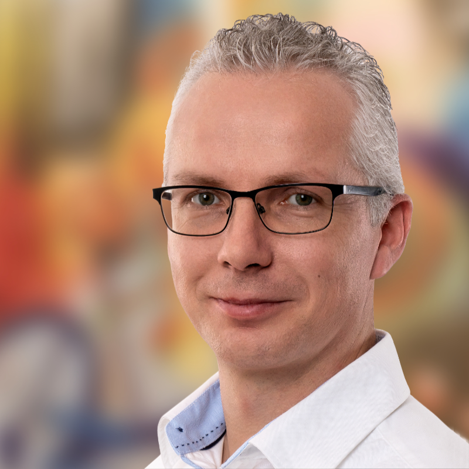
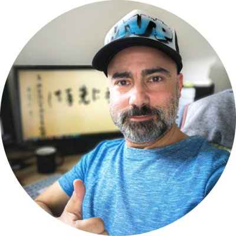

# Eure Trainer

## Harald Binkle

Fullstack & DevOps · Consultant & Trainer · Xebia

[GitHub](https://github.com/harrybin) · [LinkedIn](https://www.linkedin.com/in/harald-binkle) · [Blog](https://harrybin.de/)

## Thomas Tomow

CTO bei Xebia Germany · Co-Founder von Xebia MS Germany

Microsoft MVP für AI · Cloud, IoT und App-Lösungen

[Sessionize](https://sessionize.com/thomas-tomow) · [Profil](https://tomow.de/about-thomas-tomow/) · [Microsoft MVP](https://mvp.microsoft.com/en-US/mvp/profile/d2668071-c2ba-e711-80fc-3863bb353d80)

<!--
Harald verbindet Fullstack- und DevOps-Praxis mit Trainings- und Konferenzerfahrung. Thomas bringt langjährige Cloud- und AI-Praxis als CTO und Co-Founder sowie seine Erfahrung als Microsoft MVP ein.
Quellen: die bestehende Speaker-Seite im Repository, https://sessionize.com/thomas-tomow, https://tomow.de/about-thomas-tomow/ und das Microsoft-MVP-Profil. Portrait: https://cdn.sessionize.com/image/4af2-400o400o2-NWjy7Kqx4JXDyab3Aj1toT.png.
-->
